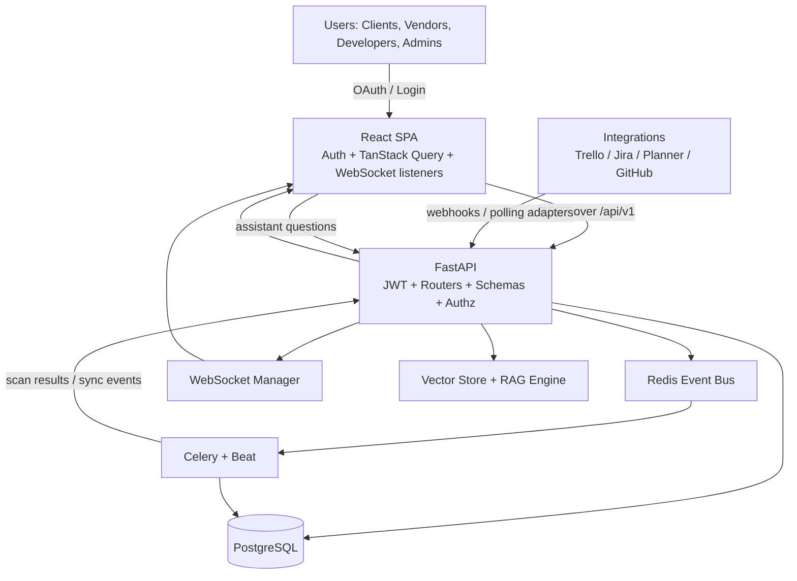
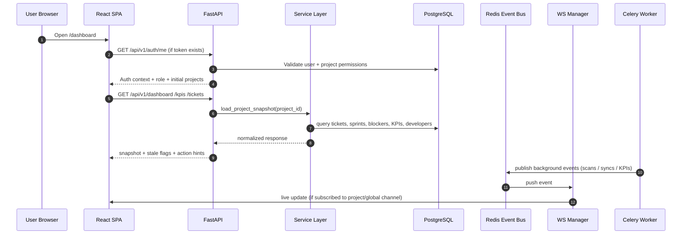
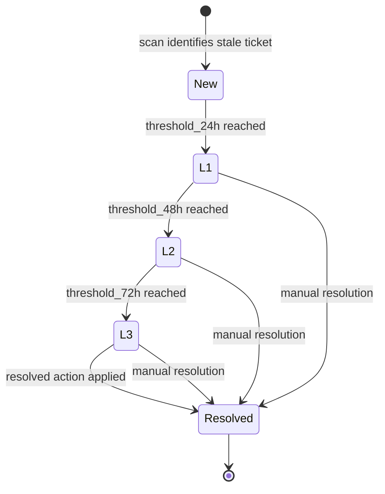
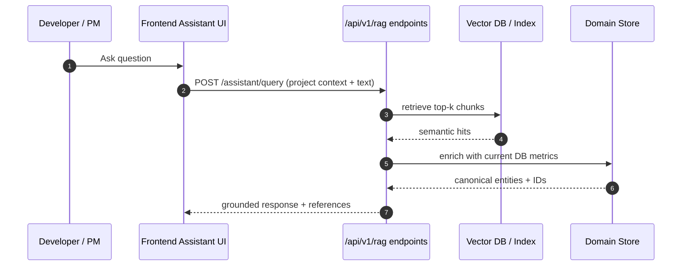
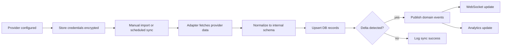
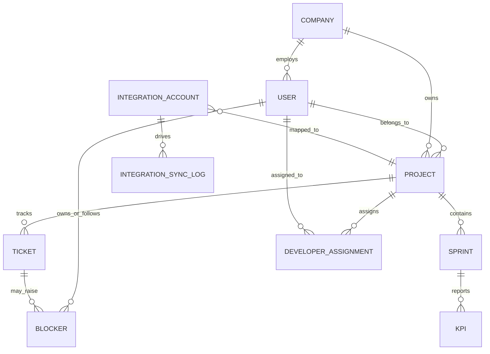
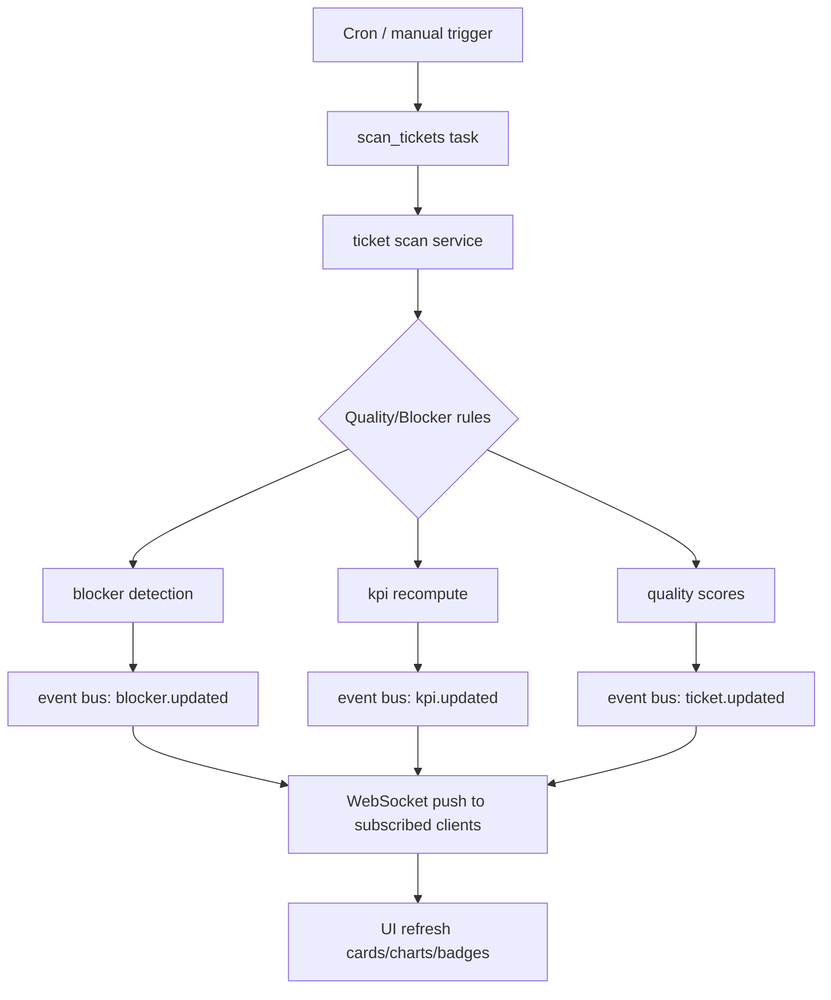
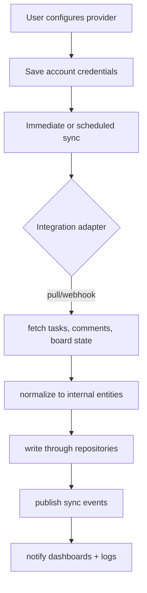
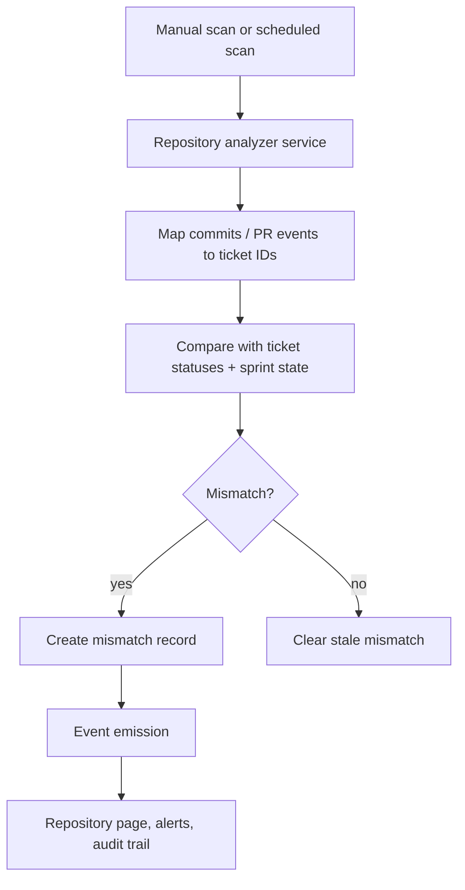

# KPIMaster

KPIMaster is a **sprint intelligence platform** for distributed delivery teams. It combines normalized task data from project tools (Trello/Jira/Planner/GitHub), a KPI engine, blocker intelligence, repository behavior checks, and role-aware dashboards to make sprint execution transparent to clients, vendors, and internal delivery leads.

The goal is to answer: **“Are we on track to deliver, why are we at risk, and what should happen next?”** in near real time.

---

## What this project aims to solve

- Manual sprint status reporting is slow and inconsistent across tools.
- Delivery risks (stale tickets, blocked items, quality regression) are detected too late.
- Client visibility and vendor delivery ownership are hard to align.
- Developer performance and responsiveness are often inferred indirectly.
- Git activity can drift from ticket state and never gets reconciled.

KPIMaster addresses these gaps by combining:

1. A unified project model across providers.
2. Continuous quality / blocker checks over that model.
3. Event-driven alerts and escalation workflows.
4. Real-time updates for dashboard consumers.
5. Optional assistant querying over synchronized delivery context (RAG-lite).

---

## Documentation map

- [Documentation Hub](docs/README.md): single entrypoint to all docs by audience and task.
- [Architecture](ARCHITECTURE.md): technical architecture, design trade-offs, deployment model.
- [Backend Guide](backend/README.md): router behavior, workers, integrations, and service boundaries.
- [Mobile App Guide](mobile/README.md): React Native + Expo mobile app setup, validation, and APK build flow.
- [Platform Details](docs/platform-details.md): deep platform architecture, lifecycle, and business context.
- [Personas and Integrations](docs/personas-and-integrations.md): who sees what and how providers are used.
- [Demo and Validation Runbook](docs/demo-and-validation-runbook.md): scenario-based validation for demos.
- [Persona Scenario Test Matrix](docs/persona-scenario-test-matrix.md): executed cross-persona matrix with pass/fail outcomes.
- [Trello Production Architecture](docs/trello-production-architecture.md): Trello-specific reliability notes.
- [Persona Productivity Guide](docs/persona-productivity-guide.md): deep role-by-role workflows and productivity outcomes.
- [Feature Deep Dive](docs/feature-deep-dive.md): detailed feature-by-feature behavior and flows.
- [App Graphs and Design Pack](docs/app-graphs-and-designs.md): visual architecture, persona flows, and UI design references.
- [Business Document](docs/business-document.md): commercial strategy, value proposition, GTM, risks, and KPIs.
- [Client Presentation Pack](docs/client-presentation-pack.md): slide-ready narrative and pitch toolkit for clients.
- [Technical & Operations Manual](docs/technical-operations-manual.md): implementation, deployment, observability, and troubleshooting depth for engineers and operators.

---

## Quick product summary

KPIMaster is a React + FastAPI application that turns sprint execution into a measurable operating surface:

- **Monitoring**: sprint KPIs, team velocity, burndown, completion trend.
- **Risk control**: blocker discovery + escalation + resolution actions.
- **Quality control**: ticket quality scoring and repository mismatch checks.
- **Collaboration**: shared project model fed by multiple integrations.
- **Visibility by persona**: client, vendor, developer, and executive views in one platform.

---

## System vision in one diagram



---

## Stack and role of each layer

### Frontend

- React 18 + TypeScript + Vite + Tailwind + shadcn/radix
- TanStack Query for cache-aware API calls
- Route-level access control by role
- Realtime updates via WebSocket subscriptions

### Backend

- FastAPI + SQLAlchemy (async) + Pydantic + Alembic
- Explicit layered architecture:
  - `api` for HTTP entrypoints and dependency-driven context
  - `services` for business orchestration
  - `domain` for events and domain behavior
  - `repositories` for DB persistence boundaries
  - `integrations` for provider normalization adapters
  - `infrastructure` for event bus, websocket manager, workers, and resilience components
- Redis for event fan-out and broker
- Celery + Celery Beat for scheduled jobs

### Shared data patterns

- Shared normalized project/task model for all tools.
- Project context is always explicit in queries where business logic is project-scoped.
- Event-driven updates (bus -> websocket) keep UI refreshed without aggressive polling.

---

## Core architecture and call flow



---

## Deep feature map

### 1) Authentication and access control

- Login and registration via `/api/v1/auth`.
- Token persisted in browser local storage (`kpimaster.authToken`) and attached in every authenticated call.
- Session restoration through `/api/v1/auth/me`.
- Frontend role checks in route composition and layout; backend enforces policy in shared authorization helpers.
- 401/invalid token events clear state and force re-auth.

### 2) Project workspace intelligence

- Projects are shared units for:
  - Tickets
  - Sprints
  - Blocker records
  - KPI calculations
  - Developer assignment and company engagement mappings
- Users can be scoped by project and tenant type, so one account can hold different operational visibility.

### 3) Sprint KPIs and dashboard

Core computed signals:

- Cycle time
- Lead time
- Completion rate
- Velocity
- Estimation accuracy
- Throughput and bug/defect rate

The sprint monitor aggregates these from normalized ticket and sprint snapshots and surfaces trends/risk indicators by project.

### 4) Ticket quality scoring

- Periodic ticket inspection checks for:
  - Missing / weak descriptions
  - Unassigned tickets
  - Missing priority markers
  - Missing estimates
  - Weak title quality
- Scores feed ticket analysis screens and quality summaries.
- Can trigger data quality alerts when quality drops.

### 5) Blocker detection and escalation

Rules identify blockers by inactivity and progression staleness:

- L1 / L2 / L3 thresholds (configurable in backend config)
- Severity is elevated as a ticket remains unresolving longer.
- Actions include prompt/resolution hints, lead escalation, and state transitions.
- Backend tracks blocker history and action trail for auditability.



### 6) Repository mismatch monitoring

- Repository analyzer compares repository activity with expected ticket state.
- Mismatches are produced when:
  - active code commits do not map cleanly to ticket progress, or
  - ticket progress does not reflect repo activity.
- Results are displayed in repository pages as risk/traceability warnings.
- In current implementation, analyzer outputs can include synthetic simulation mode in local/demo contexts depending on configuration.

### 7) Assistant workflow (RAG-lite)

- Vectorized indexing of projects/tickets/blockers/sprints/developers.
- User asks natural questions in the sprint assistant.
- Retrieval passes relevant context into answer generation.
- Assistant acts as an on-demand explanation interface for operational reports and blockers, not as an autonomous action system.



### 8) Integrations and external provider adaptation

- Normalized `TaskProvider` contract in backend integration registry.
- Provider adapters normalize external data into common models:
  - Projects / boards / lists / tasks / comments
- Trello has both generic integration endpoints and Trello-specific richer endpoints for settings/import analytics/webhooks.
- OAuth providers support token/state-managed handoff and stored account health checks.

#### Integration sync loop



### 9) Real-time updates

- Global channel for cross-project activity and project-specific subscriptions.
- UI subscribes per current project selection and refreshes relevant tables/charts when domain events arrive.
- Designed to avoid stale dashboards during active sync cycles.

### 10) Developer and partner visibility

- Developer dashboard computes personal trend/health/responsiveness metrics.
- Vendor workflows expose assigned developers, delivery progress, recruiting pool, and client history.
- Client views show customer-facing progress summaries and project heatmaps.

---

## Persona behavior and route intent

| Persona family | Main roles | Primary views | Typical questions |
| --- | --- | --- | --- |
| Solution owners / admins | `super_admin` | All operational pages | “Can I see cross-tenant integration health and global risk posture?” |
| Client admin / PM / manager | `client_admin`, `client_manager`, `client_exec`, `client_pm`, `company_admin`, `company_manager` | Dashboard, sprint, tickets, blockers, developers, client progress, repository, integrations, settings | “Which project is at risk and why?” |
| Vendor admin / delivery manager | `esn_admin`, `esn_delivery_manager` | Developer dashboard, team, repository, responsiveness, blockers | “Which developer is slowing down and what is the blocker reason?” |
| Developer | `developer` | My dashboard, history, team view where allowed | “What is my current work state and pending blockers?” |
| Auditor | `auditor_readonly` | Mostly read-only delivery views | “Can we validate status and audit trail?” |

---

## Route map (selected)

- `/login`, `/register`
- `/dashboard`
- `/sprint`, `/sprint-monitor`
- `/tickets`, `/ticket-analysis`
- `/blockers`, `/blocker-detection`
- `/developers`
- `/developer-dashboard`, `/developer-history`
- `/client-progress`
- `/vendor-dashboard`
- `/repository`, `/repository-integration`
- `/integrations`, `/settings`
- `/analytics/responsiveness`, `/responsiveness`
- `/recruiting-network`

Route behavior is determined by both authentication state and role-aware context in `src/contexts/AuthContext.tsx` and backend authorization checks.

---

## Backend surface map

Mounted under `/api/v1`:

- `/auth` — registration/login/session lookup
- `/companies` — tenant/company boundaries
- `/engagements` — client-vendor relationships and assignments
- `/projects` — project/sprint/project-level aggregates
- `/sprints` — sprint CRUD and burndown refresh
- `/tickets` — ticket CRUD, scans, filters
- `/blockers` — blocker inventory and actions
- `/developers` — developer, history, recruiting, visibility
- `/kpis` — KPI computation and snapshots
- `/repository-mismatches` — mismatch inventory and scan triggers
- `/analytics` — responsiveness and productivity analytics
- `/integrations` — generic provider onboarding and sync
- `/trello` — Trello-specific onboarding and operations
- `/ws` — WebSocket channels
- `/health`, `/metrics` — operational endpoints

---

## Data model at a glance



Entity names are simplified for documentation readability; exact ORM model names follow SQLAlchemy definitions in `backend/app/models`.

---

## Deep execution flows

### A) Login, hydration, and project selection

```mermaid
flowchart TD
  A[Open app] --> B{token exists in localStorage?}
  B -->|yes| C[GET /auth/me]
  B -->|no| D[Show login]
  C -->|valid| E[Hydrate user + projects + role permissions]
  C -->|invalid| D
  E --> F[Load default/project selected state]
  F --> G[Attach ws channel(s)]
  D --> H[POST /auth/login]
  H -->|success| I[Store token + hydrate]
```

### B) Project KPI refresh and blocker sweep



### C) Integration onboarding and sync



### D) Repository mismatch investigation



---

## Environment and setup

### Prerequisites

- Node.js 18+
- npm
- Docker and Docker Compose
- Backend runs in Docker with Postgres and Redis

### Backend config

Primary backend environment lives in `backend/.env` (start with `backend/.env.example`).

Common settings:

- `DATABASE_URL` — PostgreSQL async connection string.
- `REDIS_URL`, `CELERY_BROKER_URL`, `CELERY_RESULT_BACKEND` — worker + event infrastructure.
- `AUTH_JWT_SECRET`, `AUTH_ENABLED`, `AUTH_ACCESS_TOKEN_EXPIRE_MINUTES`.
- OAuth/API credentials for Jira, Microsoft Planner, GitHub and Trello.
- `FRONTEND_URL` for OAuth callback origins.

Frontend:

- `VITE_API_BASE_URL` (default usually `http://localhost:8000`)
- `PLAYWRIGHT_BASE_URL` for E2E flows

---

## Local run workflow

### 1) Start backend infra

```sh
cd backend
docker-compose up -d postgres redis api
docker-compose exec -T api alembic upgrade head
```

### 2) Seed data

```sh
cd backend
docker-compose exec -T api python scripts/seed.py
```

Optional demo profile:

```sh
cd backend
docker-compose exec -T api python seed_demo_flow.py
```

### 3) Start frontend

```sh
npm install
VITE_API_BASE_URL=http://localhost:8000 npm run dev
```

Typical URLs:

- Frontend: Vite URL printed by dev server (commonly `http://localhost:5173`)
- API: `http://localhost:8000`
- Swagger: `http://localhost:8000/docs`
- Health: `http://localhost:8000/health`
- Metrics: `http://localhost:8000/metrics`

---

## Demo personas

Standard seed creates:

- `e2e` / `E2ePassword1!` (`client_admin` super user-like role)
- `horizon_admin` / `ChangeMe123!` (`client_admin`)
- `horizon_exec` / `ChangeMe123!` (`client_exec`)
- `retail_pm` / `ChangeMe123!` (`client_pm`)
- `hexadev_admin` / `ChangeMe123!` (`esn_admin`)
- `novaforge_delivery` / `ChangeMe123!` (`esn_delivery_manager`)
- `alice_account`, `david_account`, `grace_account` with `developer` roles

Focused demo flow creates:

- `norma_admin` / `Password123!` (`client_admin`)
- `tawssil_admin` / `Password123!` (`esn_admin`)
- `hejer_dev` / `Password123!` (`developer`)

Always verify seeded data via:

```sh
cd backend
docker-compose exec -T api python scripts/validate_data_quality.py --profile demo
```

---

## Testing and quality checks

### Frontend

```sh
npm run lint
npm run typecheck
npm run test
npm run test:coverage
npm run build
npm run test:e2e
```

### Backend

```sh
cd backend
docker-compose exec -T api pip install -r requirements-test.txt
docker-compose exec -T api python -m pytest tests -q
docker-compose exec -T api python -m pytest tests --cov=app --cov-report=term-missing
```

### Data quality validation

```sh
cd backend
python scripts/validate_data_quality.py --profile schema
python scripts/validate_data_quality.py --profile demo
```

---

## Troubleshooting

- **Frontend cannot reach backend**  
  Ensure API is running, `VITE_API_BASE_URL` is correct, and `http://localhost:8000/health` is healthy.

- **Immediate logout after login**  
  Confirm the JWT secret did not rotate and `/auth/me` can be validated.

- **No projects in UI**  
  Run demo seeding and re-login.

- **Migration issues**  
  Run `alembic upgrade head`; recreate local Postgres only if this is disposable.

- **OAuth/provider issues**  
  Validate redirect URI, token scopes, and provider credentials; check integration health endpoints.

---

## Production guidance

- Use non-default secrets in non-local environments.
- Keep provider secrets encrypted and never committed.
- Enforce HTTPS and precise CORS origins.
- Run API and worker migrations before traffic shift.
- Use dedicated DB/Redis in production; monitor sync failures and queue depth.
- Keep `/docs` protected unless explicit internal use requires exposure.

---

## Non-functional characteristics

- **Consistency model**: API reads are mostly fresh from PostgreSQL; many surfaces are asynchronously refreshed after sync and scan tasks.
- **Failure handling**: integration/provider sync errors are recorded and exposed via sync logs.
- **Security posture**: role-aware frontend routes plus backend policy checks; encrypted integration secrets; token-based auth.
- **Observability**: health, metrics, logs, and sync/worker traces are expected for production visibility.

---

KPIMaster is intended to be both a management dashboard and a **decision engine**: it aggregates operational signals into visible actions so teams can act before the sprint slips.

- [Business Document](docs/business-document.md): commercial strategy, value proposition, GTM, pricing, risks, and KPI framework.
