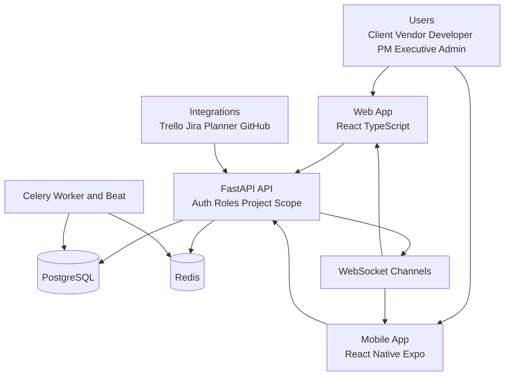
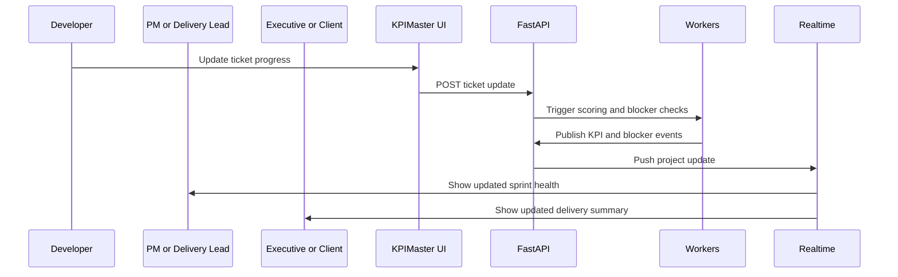
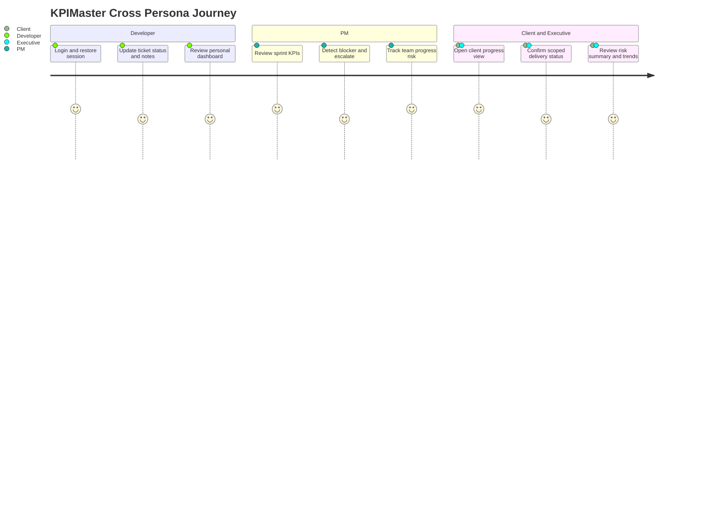
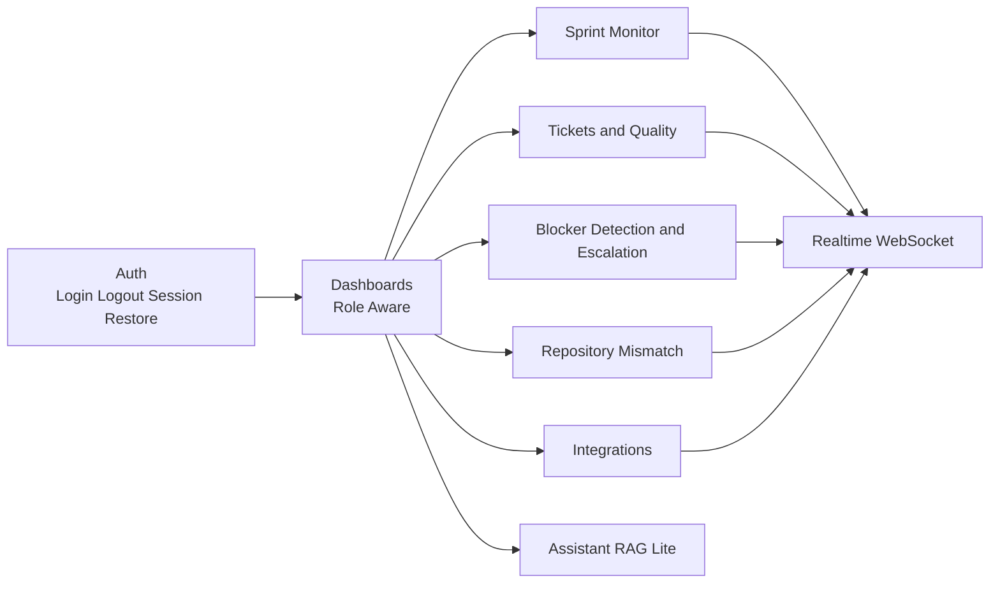
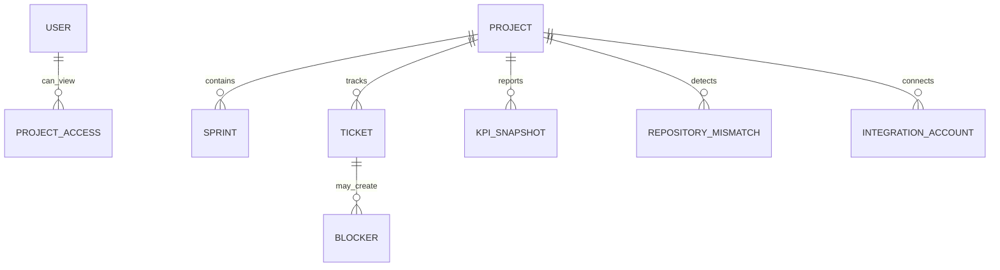
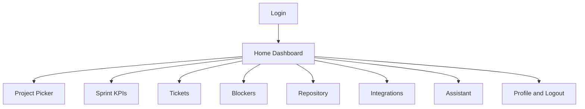
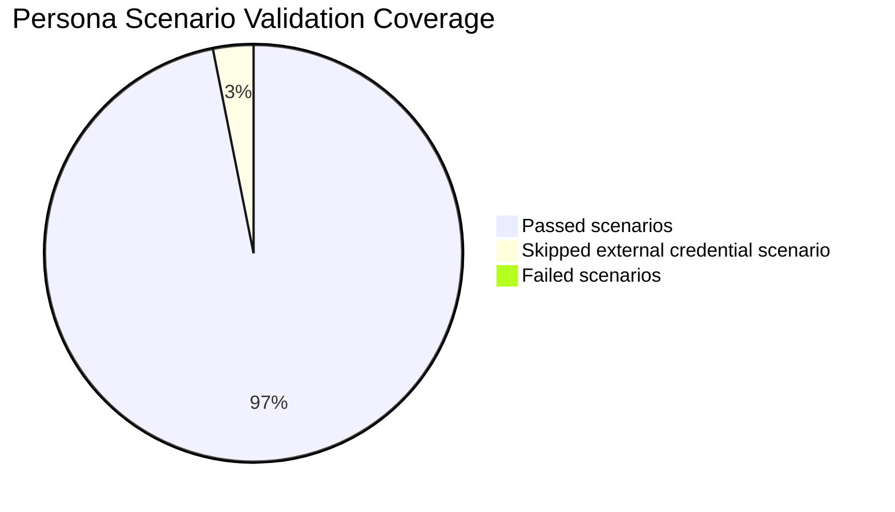

# KPIMaster App Graphs and Design Pack

This file contains visual graphs and design references for KPIMaster.

## 1) System Architecture Graph

## 2) End-to-End Delivery Flow

## 3) Persona Journey Graph

## 4) Product Surface Map

## 5) Data Model Snapshot

## 6) Design System Direction

### Visual goals

- Clear hierarchy for operational decisions
- Strong contrast for risk states
- Dense but readable KPI surfaces
- Touch-safe controls for mobile

### Color tokens

| Token | Hex | Usage |
| --- | --- | --- |
| `--bg` | `#0B1220` | Primary dark background |
| `--surface` | `#111B2E` | Cards and panels |
| `--text` | `#EAF1FF` | Main text |
| `--muted` | `#94A3B8` | Secondary text |
| `--ok` | `#16A34A` | Healthy status |
| `--warn` | `#D97706` | Watch status |
| `--danger` | `#DC2626` | Risk and blocker status |
| `--info` | `#0284C7` | Informational accents |

### Typography direction

- Headings: `Space Grotesk` or `Manrope`
- Body: `Inter` or `Plus Jakarta Sans`
- Numeric KPI values: tabular figures enabled

### Spacing and layout rules

- Base spacing scale: `4 8 12 16 24 32`
- Card radius: `8px`
- Minimum touch target on mobile: `44px`
- Dashboard grid: 12-column desktop, 4-column mobile

## 7) Mobile Navigation Blueprint

## 8) Validation Dashboard Graph

