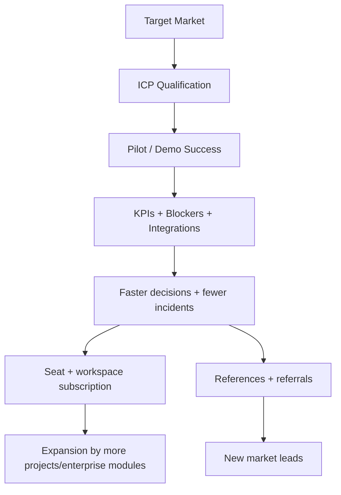

# KPIMaster Business Document

## 1) Executive Summary

KPIMaster is a B2B SaaS platform that transforms fragmented sprint delivery data into a single operational intelligence surface for distributed software teams. It combines task synchronization, KPI computation, blocker detection, repository behavior checks, and role-aware reporting to improve delivery predictability for clients, vendors, and internal teams.

The core commercial promise is:

- Faster visibility into delivery health
- Earlier risk detection
- Faster corrective action
- Fewer coordination delays between clients, vendors, and developers

KPIMaster is strongest for delivery-heavy organizations where multiple external tools create fragmented reporting.

---

## 2) Problem Statement

Most teams experience three compounding issues:

1. **Fragmented operations data**
   - Work exists in Trello/Jira/GitHub/Planner.
   - Status and quality signals are not normalized.
2. **Delayed risk response**
   - Blockers are noticed late.
   - Metrics drift without clear ownership.
3. **Misaligned stakeholder views**
   - Executives need summaries.
   - PMs need actionable tickets.
   - Vendors need developer-level performance.

This mismatch creates delayed decisions, missed commitments, and manual reporting overhead.

---

## 3) Solution

KPIMaster solves this by combining:

- Multi-provider integration and normalization layer
- Real-time project and sprint signal engine
- Automated blocker + quality analysis
- Repository-task alignment checks
- Role-based dashboards and permissions
- Assistant-assisted operational explanations

### Value proposition (one line)

**“Turn delivery data chaos into coordinated, actionable execution signals.”**

---

## 4) Vision and Mission

**Vision**

To become the operating layer for all execution-critical delivery signals in remote and outsourced software work.

**Mission**

To reduce time-to-decision and decision error in sprint operations by centralizing data, automating risk detection, and aligning stakeholder actions.

---

## 5) Target Market and ICP

### Primary ICP

- Agencies and digital transformation teams
- Outsourcing vendors managing multiple client engagements
- Product teams with distributed engineering contractors
- Program teams with mixed tooling and multi-stakeholder reporting

### Buyer personas

1. Delivery operations lead (problem owner)
2. CTO/Head of Delivery (strategic owner)
3. PMO or program manager (execution owner)
4. Vendor account manager
5. Client operations executive

### Pain point fit by segment

- **Agencies**: low visibility across vendor/developer allocations
- **Enterprises**: fragmented PM tool and Git workflows
- **Fintech / regulated teams**: need traceable delivery evidence and audit trails

---

## 6) Product Positioning

### What KPIMaster is

A platform intelligence layer for sprint execution—not a replacement for Jira/GitHub, but a unifying operations surface.

### What KPIMaster is not

- Not a full source-code versioning platform
- Not a substitute issue tracker replacement
- Not a generic AI chatbot platform

### Positioning statements

- Compared to tool-specific dashboards: KPIMaster is **cross-tool**.
- Compared to static reporting: KPIMaster is **operational and near real-time**.
- Compared to manual PM coordination: KPIMaster is **automated and role-aware**.

---

## 7) Business Model

### Core model

- SaaS subscription by seats and workspace tiers.
- Optional premium modules (advanced assistant analytics, high-volume workers, enterprise compliance pack).

### Revenue streams

1. **Subscription seats**
   - Admin seats (client/vendor/operations)
   - Developer seats (read/write or read-only profile)
2. **Workspace/engagement fee**
   - Project or tenant-based pricing for large enterprises
3. **Add-on services**
   - Integration setup support
   - Custom analytics workbooks
   - Dedicated deployment + support
4. **Professional services (optional)**
   - Onboarding, KPI design, training and executive coaching

### Early commercial strategy

- Pilot with one managed client portfolio.
- Expand per vendor ecosystem via referral/partnership channels.
- Offer executive dashboards as low-friction upsell once reporting maturity is proven.

---

## 8) Unit Economics Hypothesis

- **ACV (Average Contract Value)**: tied to number of active projects, roles, and connector volume
- **Gross margin target**: cloud infrastructure + support-driven margin optimization
- **Expansion levers**
  - Add more projects per tenant
  - Add premium visibility and compliance modules
  - Add enterprise SSO, audit bundles, SLA packs

### Cost drivers (likely)

- Cloud execution (API + DB + Redis + worker compute)
- Provider API reliability dependencies
- Sales support and onboarding effort
- Model/assistant compute costs if LLM features are scaled beyond retrieval

---

## 9) Adoption Plan

### Phase 1: Product-led validation

- Run seeded demo with 1–2 client stories.
- Validate KPI + blocker + integration pipeline across 1 client + 1 vendor stack.

### Phase 2: PMO rollout

- Onboard PM teams using existing Trello/Jira workflows.
- Train role-specific operations (client admin, vendor manager, exec).

### Phase 3: Multi-vendor scale

- Add visibility governance for many vendor teams and cross-project contexts.
- Introduce analytics for responsiveness and portfolio health.

### Phase 4: Enterpriseization

- Enforce stronger access governance.
- Introduce audit templates, policy controls, and compliance reporting.

---

## 10) Pricing and Packaging (starter sample)

> Replace with validated pricing from go-to-market research before publication.

- **Starter**
  - Small teams, limited projects
  - Core dashboards + blocker + KPI basics
- **Growth**
  - Multiple integrations, team KPIs, responsiveness + recruiter workflows
  - Higher seat cap
- **Scale**
  - Dedicated workers, enterprise governance, custom reports, advanced support
- **Enterprise**
  - Advanced security, SLA, compliance-oriented templates, dedicated account support

---

## 11) Go-to-Market (GTM)

### Positioning channels

- Founder-led outreach to known outsourcing/PM communities
- Partnerships with delivery consultancies
- Product-led inbound via demo readiness stories

### Sales motion

- Technical validation call with current PM/integration stack
- 2-week pilot with 1 primary project
- Expansion to full portfolio after measurable improvement

### Core message

- “Stop guessing sprint progress from multiple systems.”

---

## 12) Differentiators

1. **Normalized operations model** across multiple work providers
2. **Integrated risk automation** (blockers + quality + mismatch + responsiveness)
3. **Role-aware surfaces** for different personas
4. **Near real-time updates** via events and websocket feed
5. **Operational workflows** that support executives and hands-on developers in one platform

---

## 13) Competitive landscape

### Typical alternatives

- Native tool dashboards (limited to one provider)
- BI layers over exports (often stale or labor intensive)
- Custom internal scripts/spreadsheets

### KPIMaster edge

- Faster standardization of external workflows
- Better cross-stakeholder consistency
- Lower time-to-insight for non-technical roles

---

## 14) Risks and mitigations

### Product risks

- Provider API changes and rate limits
  - Mitigation: adapter versioning and connector monitoring.
- Poor data quality in upstream tools
  - Mitigation: quality scoring + integration health + operational hygiene.
- Alert fatigue
  - Mitigation: threshold tuning + role-based relevance rules.

### Market risks

- Adoption resistance due to existing dashboards
  - Mitigation: executive-first onboarding and immediate KPI value in first session.
- Long onboarding effort in strict enterprises
  - Mitigation: phased onboarding templates and template-based integration packs.

### Execution risks

- Underestimating support burden from multi-tenant onboarding
  - Mitigation: standardized onboarding playbooks and templates.

---

## 15) KPI framework (business success)

Track these from day one:

- `Time-to-insight`: median time to identify delivery risk
- `Blocker resolution time`: median duration from L1/L3 and by team
- `Status reconciliation time`: time to prepare a client-facing update
- `Onboarding cycle time`: days to first connected project and first meaningful dashboard
- `Active project retention`: projects actively used after 30/60/90 days
- `Seats per tenant`: expansion signal by engagement depth

---

## 16) Operating model

### Internal team

- **Product**: roadmap around integration reliability and analytics depth
- **Engineering**: API, workers, adapter reliability, observability
- **Customer success**: onboarding, tenant health, usage coaching
- **Sales/marketing**: ICP targeting and reference deployment

### Delivery operations

- Weekly health review of sync and scan jobs
- Monthly portfolio review by persona usage and adoption
- Quarterly roadmap recalibration from customer feedback

---

## 17) Roadmap (next 12 months)

- Q1: stabilize integrations + expand role templates + reporting hardening
- Q2: advanced blocker playbooks and executive packs
- Q3: enterprise governance (audit exports, compliance policy layers)
- Q4: predictive risk scoring and benchmark packages

---

## 18) Business architecture map

---

## 19) Strategic fit with current platform

This business model aligns with current capabilities:

- Multi-role workspace already enables differentiated pricing by seat and tenant depth.
- Integration adapters create defensibility through connectivity coverage.
- Real-time event model supports premium monitoring promises.
- Data quality and blocker workflows reduce churn in complex operations.

KPIMaster is commercially strongest when positioned as a **delivery intelligence dependency**, not just another PM report.

---

## 20) Decision points for launch

Before commercial launch, define:

1. Final pricing bands and seat constraints.
2. Minimum SLA commitments per tier.
3. Customer onboarding standards (first 14-day playbook).
4. Security/compliance commitments for enterprise tiers.
5. Clear usage limits and overage policy.

---

## 21) Go-live checklist (business)

- Confirm at least one client-admin + one vendor workflow proof point.
- Confirm blocker lifecycle and report accuracy in live demo scenario.
- Confirm one executive summary deck can be produced in under 15 minutes.
- Confirm integration health is stable for first 2 months of pilot usage.
- Confirm support and escalation path is documented.

---

KPIMaster is positioned as a practical, scalable delivery intelligence business with a clear path from proof of concept to enterprise rollout.
