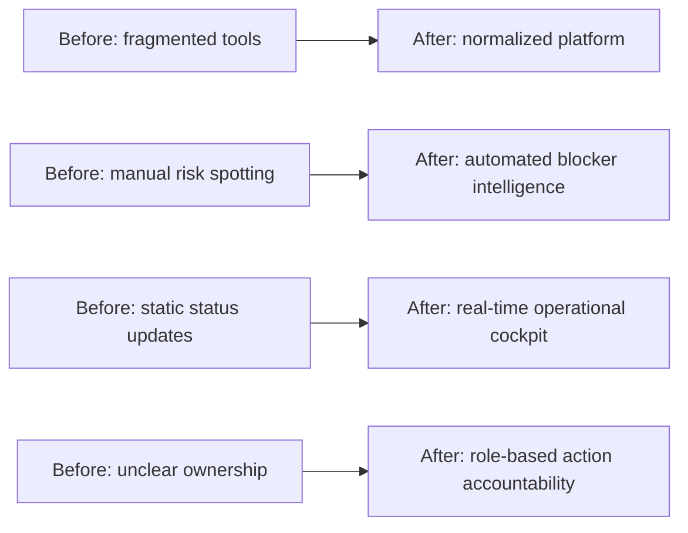
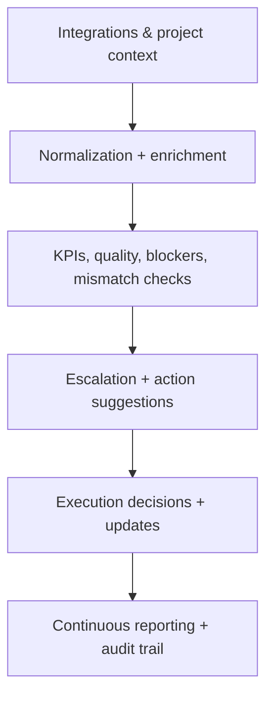
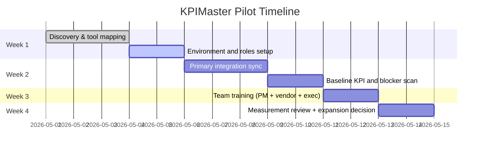

# KPIMaster Client Presentation Pack

> Purpose: A presentation-ready, business-to-technical documentation pack for client meetings, discovery calls, POCs, and board-level reviews.

This file is organized so you can copy sections directly into slides.

---

## 0) One-minute project elevator

**KPIMaster** is a sprint intelligence platform that unifies project data from Trello, Jira, Microsoft Planner, and GitHub into one execution cockpit. It detects risk early (quality issues, blockers, repository mismatches), shows role-specific views, and gives teams near real-time operational clarity for faster delivery decisions.

### Value in one sentence

`From fragmented task tools to one source of truth for delivery decisions.`

---

## 1) What clients need before KPIMaster

### Common customer pain points

1. **No unified truth**: multiple tools, inconsistent status.
2. **Late risk discovery**: blockers are found after schedule impact.
3. **Difficult stakeholder alignment**: exec/client/team views are different and delayed.
4. **No objective quality baseline**: weak tickets hide planning risk.
5. **Low audit readiness**: manual proof for progress and decisions.

### Why these are business risks

- Missed deadlines.
- Unreliable client communication.
- Vendor/client trust erosion.
- Rework due to misunderstood priorities.

---

## 2) Core narrative: “Before → After” story

### Suggested positioning language

- “KPIMaster does not replace your project tools, it orchestrates them into delivery intelligence.”
- “We measure not only what is done, but why it is at risk and what to do next.”

---

## 3) Slide deck blueprint (ready-to-copy)

## Slide 1 — Cover
**Title:** KPIMaster: Delivery Intelligence for Distributed Sprint Teams

**Presenter notes:**
- Company + presenter name.
- One-liner of your value: sprint risk visibility + accountability.

---

## Slide 2 — Audience context
**Title:** Who this solution is for

**Bullets:**
- Delivery leaders
- Client PMs and executives
- Vendor operations teams
- Engineering developers

**Visual:** persona icons with one-line pain each.

---

## Slide 3 — Business pain
**Title:** Why teams lose execution time today

**Bullets:**
- Tool fragmentation
- Delayed blocker discovery
- Mixed-quality task definitions
- Poor vendor/client reporting alignment

**Visual:** “tool island” map with arrows and silos.

**Presenter notes:** connect this to their current stack.

---

## Slide 4 — What KPIMaster changes
**Title:** One platform for planning truth and action

**Bullets:**
- Cross-tool normalized data model
- Role-aware dashboards
- Automated risk signals
- Real-time update layer

**Visual:** high-level architecture diagram from README.

---

## Slide 5 — Operational workflow overview
**Title:** From integration to decision in one loop

---

## Slide 6 — Platform architecture
**Title:** Technical trust: how this works safely

**Bullets:**
- React SPA (role-based views)
- FastAPI backend
- PostgreSQL for source state
- Redis event bus + Celery workers
- WebSockets for updates
- Provider adapters for Trello/Jira/Planner/GitHub

**Speaker note:** Emphasize that integrations are normalizing and scoped per project.

---

## Slide 7 — Persona-first design
**Title:** Right person, right view, right action

**Bullets:**
- Clients: outcome and risk summary
- Vendors: developer and assignment control
- Developers: own backlog and blockers
- Auditors: traceability and visibility

**Visual:** matrix mapping role vs page/action.

---

## Slide 8 — KPIs that matter
**Title:** Delivery health signals made measurable

**Bullets:**
- Completion rate
- Velocity / throughput
- Cycle and lead time
- Estimation accuracy
- Responsiveness
- Blocker aging and escalation

**Visual:** trend cards mockup.

---

## Slide 9 — Blocker intelligence
**Title:** Detect, escalate, resolve faster

**Bullets:**
- Automatic detection by inactivity thresholds
- L1/L2/L3 escalation progression
- Actionable ownership trail

**Visual:** state machine diagram.

---

## Slide 10 — Ticket quality assurance
**Title:** Quality issues are resolved before execution

**Bullets:**
- Missing description
- Missing assignee / priority / estimate
- Weak title and incomplete metadata
- Quality impact on planning reliability

**Visual:** example quality score card.

---

## Slide 11 — Repository alignment
**Title:** Code and ticket state reconciled

**Bullets:**
- Detect when ticket state and repository signals disagree.
- Surface mismatch as traceability exceptions.

**Presenter note:** Helps reduce executive/client disputes and internal blame loops.

---

## Slide 12 — Real-time collaboration
**Title:** No stale views, fewer meetings

**Bullets:**
- Backend events from scans/syncs
- WebSocket distribution to dashboard
- Reduced manual refresh and polling dependency

**Visual:** event flow to frontend clients.

---

## Slide 13 — Demo flow (short)
**Title:** 12-minute proof walk-through

1. Login + role context
2. Project dashboard and KPI health
3. Ticket quality + blocker drill-down
4. Integration sync status and logs
5. One blocker escalation action
6. Repository mismatch check
7. Summary + next step

**Visual:** numbered timeline.

---

## Slide 14 — Security & governance
**Title:** Why ops teams can trust the data

**Bullets:**
- Role-based access control in UI + API
- Project-scoped data visibility
- Encrypted integration credentials
- Health, metrics, logs, and audit artifacts

---

## Slide 15 — Deployment and onboarding
**Title:** Quick start to value

**Bullets:**
- Local demo environment
- Seeded personas and flows
- Integration onboarding pattern
- Validation checks before go-live

**Visual:** onboarding timeline (Day 1, Day 3, Day 7, Day 30).

---

## Slide 16 — Business impact (client outcomes)
**Title:** What improves after adoption

- Faster issue detection
- Faster escalation and ownership
- Lower status prep effort
- Better estimation confidence
- Transparent cross-party communication

**Visual:** before-vs-after KPI chart placeholders.

---

## Slide 17 — ROI framework
**Title:** How we prove impact

### Core impact formula

`Delivery Risk Reduction (%) = (Risk Events baseline - Risk Events after) / baseline × 100`

`Time-to-Action Improvement = Avg(Decision time before) - Avg(Decision time after)`

### KPIs to track with customer

- Blocker response time
- Missed deadline frequency
- Rework due to ambiguous status
- Meeting preparation time

---

## Slide 18 — Pricing conversation starter
**Title:** Commercial positioning options

**Bullets:**
- Per-seat + workspace model
- Optional premium modules (advanced analytics, support, enterprise controls)
- Pilot-to-enterprise expansion path

**Presenter note:** Keep pricing discussion separate if needed; align with project count and integrations first.

---

## Slide 19 — Risks and mitigations
**Title:** Transparent implementation risks

**Bullets:**
- Provider API limits / outages
- Data quality variability
- Team adoption curve
- Alert fatigue

**Mitigations:** thresholds, phased rollout, onboarding support, health checks.

---

## Slide 20 — Recommended next steps
**Title:** Decision and action plan

1. Select pilot project and stakeholders.
2. Connect one primary tool and 1–2 repositories.
3. Run baseline report and first sprint scan.
4. Train 2–3 owners per role.
5. Review 14-day value metrics.

---

## 4) Deep feature pack (for technical buyers)

## 4.1 Integration engine

**What to explain:**
- Standardized provider contract for board/project/task/comment extraction.
- Syncs can be scheduled or triggered.
- All fetched data mapped to internal normalized entities.

**Why clients care:**
- They keep existing tools, but reduce cognitive switching.

## 4.2 KPI layer

**What to explain:**
- Derived from sprint/ticket states and timestamps.
- Recalculated by reads and background jobs.
- Supports operational and executive readability.

**Why clients care:**
- Better sprint predictability and less reactive management.

## 4.3 Blocker engine

**What to explain:**
- Staleness thresholds and escalation stages.
- History and actionability stored as structured events.

**Why clients care:**
- Reduces hidden waiting and creates ownership discipline.

## 4.4 Assistant layer

**What to explain:**
- Semantic lookup over indexed project context.
- Supports Q&A around blocked work and project trajectory.

**Why clients care:**
- Reduces time for context restoration across teams.

## 4.5 Security and compliance posture

**What to explain:**
- API and route-level authorization.
- Secret storage through encrypted provider credentials.
- Separate project + tenant scopes.

**Why clients care:**
- Avoids over-sharing across clients/vendors, especially important in outsourcing ecosystems.

---

## 5) Customer-facing proof story (template)

### Situation

- 1,000+ tasks across 3 client projects.
- Two provider tools and one Git repository.
- Weekly reporting delays and recurring sprint slips.

### Intervention

- Integrate providers to KPIMaster.
- Define project roles and escalation thresholds.
- Enable blocker workflow and repository mismatch checks.

### Result

- Risk events reported earlier.
- Client update time reduced.
- More actionable developer assignment decisions.

### Quantification section (fill with real numbers)

- Avg blocker resolution time: `__ mins`
- Status report preparation time: `__ mins`
- % of late blockers visible before standup: `__%`

---

## 6) Discovery questionnaire (client intake)

Use this in discovery sessions to qualify and scope quickly.

1. Which tools feed current sprint operations?
2. Who approves blocker decisions?
3. How long between blocker creation and resolution?
4. What is your current client reporting cycle?
5. Are project data access boundaries cross-vendor?
6. Is repository/task state reconciliation currently manual?
7. Which users need executive-level versus operational-level views?
8. What metrics are used for leadership reviews?

Collect responses in a one-pager, then map directly to slide 1–5 and pricing recommendations.

---

## 7) Demo script (talking points)

### 0:00–1:30 | Opening
- Start with execution pain.
- Introduce KPIMaster as a control layer.

### 1:30–4:00 | Credentials and trust
- Show auth/session + role-based entry.
- Explain scoped visibility.

### 4:00–7:00 | Decision surface
- Open dashboard, sprint KPIs, trend cards.
- Explain what changed since last sprint window.

### 7:00–9:00 | Risk controls
- Show blockers and their progression levels.
- Execute one representative action.

### 9:00–11:00 | Data quality and quality alerts
- Show ticket quality score and explain planning impact.

### 11:00–13:00 | Repo and integrations
- Show sync status, provider health, mismatch sample.

### 13:00–15:00 | Role view close
- Flip to vendor/developer/executive view.
- End with “decision improvement in one screen”.

---

## 8) Sales objection handling

### “We already use Jira/Trello.”
**Response:** KPIMaster does not replace tools. It normalizes outputs and adds delivery intelligence, cross-role visibility, and risk workflows.

### “Too complex to onboard.”
**Response:** Start with one project and one integration, then expand after first risk cycle.

### “Will this add overhead?”
**Response:** Most configuration is one-time. Ongoing benefit is less manual reconciliation and faster decisions.

### “Can we trust automated suggestions?”
**Response:** Every recommendation is tied to rules, timestamps, and action history for auditability.

---

## 9) Implementation timeline for clients

> Replace dates with real dates; keep relative durations if you prefer.

---

## 10) Reusable deck pack: two audience versions

### A) Executive version (8–10 slides)
- Problem
- KPIs and risk summary
- Business impact
- Security and governance
- Timeline and decision

### B) Technical operations version (12–16 slides)
- Architecture
- Integration workflow
- Background jobs / event pipeline
- Scaling and reliability practices
- Quality and mismatch detection

---

## 11) Pre-presentation readiness checklist

- [ ] Project and integration context confirmed (tool names, tenant boundaries)
- [ ] At least one role mapped (client admin/vendor manager/developer)
- [ ] Seed/real project data loaded
- [ ] One blocker candidate available or demonstrated
- [ ] Metrics baseline captured
- [ ] Slide deck customized with client logos and terminology

---

## 12) Suggested KPI deck appendix

| KPI | Baseline | Target after 30 days | Target after 90 days |
| --- | --- | --- | --- |
| Decision latency (minutes) | 120 | 70 | 40 |
| Blockers discovered after due date (%) | 22% | 10% | 5% |
| Sprint status prep time (mins/week) | 90 | 50 | 30 |
| Repo-ticket mismatch incidence | 18% | 10% | 4% |
| Stakeholder confidence index* | 2.8/5 | 3.8/5 | 4.4/5 |

`*` subjective scale from client review.

---

## 13) Appendix: one-page “platform deep summary” snippet

**KPIMaster is ideal for:**
- teams with mixed tools,
- organizations needing fast visibility,
- and ecosystems where outsourcing and client expectations require measurable accountability.

**Technical strengths:**
- normalized integration model,
- asynchronous compute with websocket updates,
- role-driven delivery workflows,
- and explicit blocker + quality + mismatch intelligence.

**Business strengths:**
- fewer manual status cycles,
- faster execution decisions,
- stronger evidence for reporting,
- measurable delivery reliability.

---

## 14) How to convert this doc into a presentation quickly

1. Copy section “Slide deck blueprint” in order.
2. Replace placeholder numbers in ROI and KPI tables.
3. Insert your client’s current stack logos on architecture and integration slides.
4. Add one real blocker/ticket screenshot from staging.
5. Keep speaker notes in your team shared notes during client calls.

---

## 15) Quick links from this ecosystem

- [Platform Details](./platform-details.md)
- [Feature Deep Dive](./feature-deep-dive.md)
- [Persona Productivity Guide](./persona-productivity-guide.md)
- [Business Document](./business-document.md)
- [Demo Runbook](./demo-and-validation-runbook.md)

---

This pack is intentionally deep and client-ready; adapt wording to client language and sector requirements before sending externally.
