# KPIMaster Feature Deep Dive

This document explains every major feature in detail, with explicit _before_, _flow_, and _after_ sections for each one, plus Mermaid diagrams showing how major subsystems move together.

## Purpose

KPIMaster is designed to make sprint execution visible and actionable for multiple personas (clients, vendors, developers, executives, and admins) by combining:

- A normalized task and project model.
- Background intelligence that continuously scans for risks.
- Real-time updates and role-based operational views.
- Provider integrations so data is imported once, then measured everywhere.

---

## 1) Authentication & session lifecycle

**Why it exists**: Every action must be authenticated and traceable. Without a secure identity layer, project data can be exposed incorrectly.

### Before
- User enters app with no active session.
- Protected routes and sensitive API endpoints must reject access.

### Steps
1. User submits credentials at `/login`.
2. Frontend calls `POST /api/v1/auth/login`.
3. Backend validates credentials and returns JWT.
4. Frontend stores token in browser storage (`kpimaster.authToken`).
5. All future API calls include `Authorization: Bearer <token>` via `apiFetch`.
6. On app boot or refresh, frontend calls `GET /api/v1/auth/me`.
7. If token is invalid/expired, backend returns `401` and app clears session.

### After
- Session is established with user identity + role context.
- API and pages become accessible according to permissions.
- Invalid session is auto-recovered to login state.

### Diagram

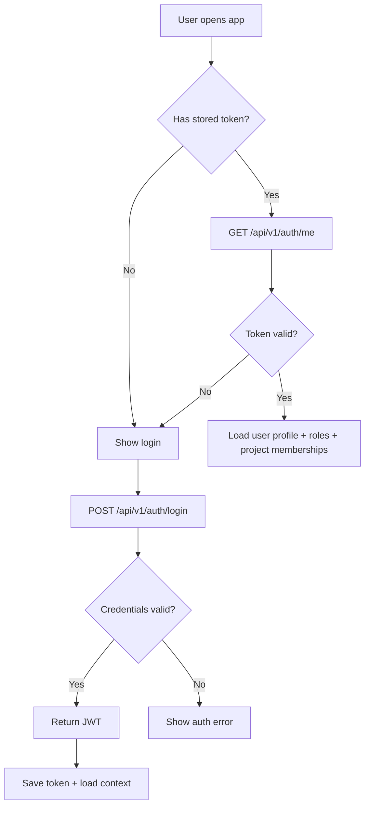

---

## 2) Tenant-aware authorization (RBAC)

**Why it exists**: Roles and tenants determine who can see and do what.

### Before
- A user is authenticated but access scope is undefined for specific pages.

### Steps
1. App resolves user roles from backend session payload.
2. Route-level guards compute allowed paths.
3. Backend API dependencies check role + tenant/project scope before every sensitive action.
4. UI filtering hides unsupported pages/components.
5. Unauthorized operations are blocked on both UI and API.

### After
- Clients, vendors, developers, and auditors receive different UI surfaces and action sets.
- Company boundaries and tenant roles are respected in both request and render layers.

### Diagram

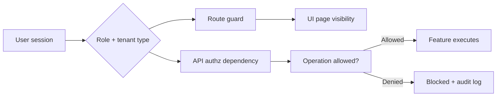

---

## 3) Project context selection

**Why it exists**: Nearly every KPI and risk score is project-scoped.

### Before
- User logs in with potentially multiple projects.
- No selected project means ambiguous analytics and wrong drilldowns.

### Steps
1. On startup, load assigned projects.
2. User chooses a project from sidebar or URL context.
3. Frontend stores active project context in app state.
4. API calls include `project_id` through query params or body where needed.
5. Backend filters all reads/writes to that project.

### After
- Dashboard and workflows run on a single project boundary.
- Metrics, blockers, assignments, and repository checks become meaningful.

### Diagram

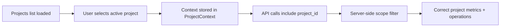

---

## 4) Sprint KPI snapshot and sprint dashboard

**Why it exists**: Leaders need one coherent health view of delivery progress.

### Before
- Teams track completion manually across several views.
- No continuous aggregate signal exists.

### Steps
1. Frontend requests sprint details and ticket set for active project.
2. Backend service layer aggregates historical and current sprint data.
3. KPIs are computed: cycle time, lead time, velocity, completion rate, throughput, estimation accuracy, bug/defect indicators.
4. Dashboard receives enriched snapshot.
5. Cards/charts refresh and highlight trends.

### After
- One place to evaluate sprint health and risk.
- Faster executive and PM decision-making.

### Diagram

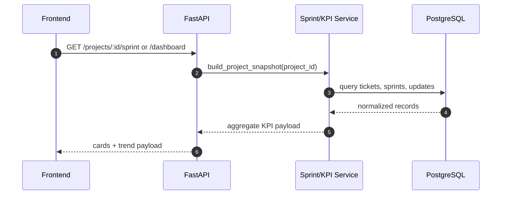

---

## 5) Ticket quality scoring

**Why it exists**: Weak backlog quality degrades estimates, planning, and execution.

### Before
- Tickets with incomplete metadata silently enter sprint flow.

### Steps
1. Ticket scan service inspects description, title, assignee, priority, and estimation fields.
2. Scoring logic assigns quality signals and optional recommendations.
3. Scores are grouped into ticket-level details and summary views.
4. Users can act on low-quality tickets before execution.

### After
- More complete ticket definitions.
- Reduced planning noise and less rework due to unclear requirements.

### Diagram

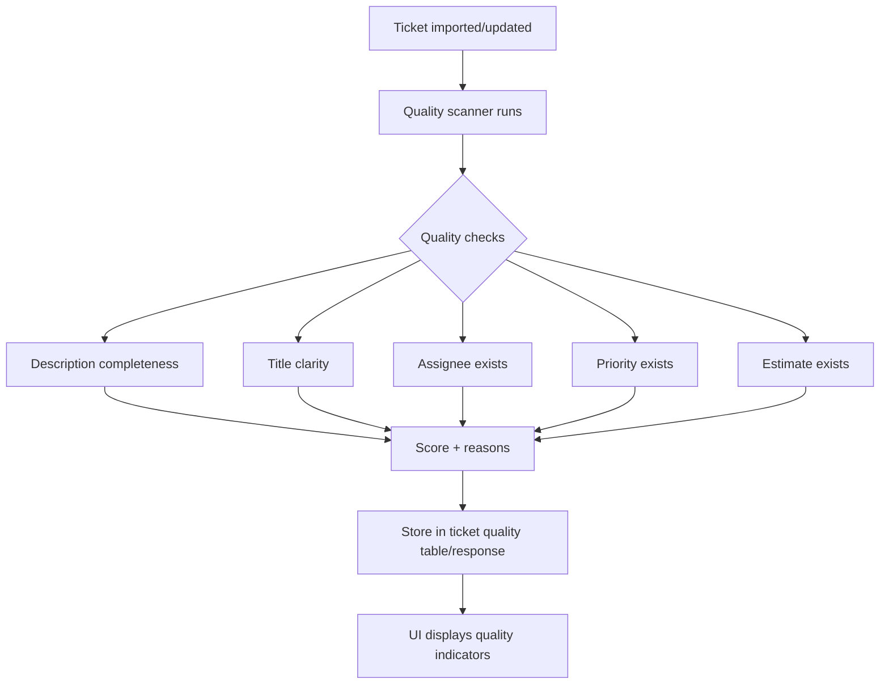

---

## 6) Blocker detection

**Why it exists**: Stalled tickets are the first sign of delivery risk.

### Before
- Delays are noticed late, often by periodic manual check-in.

### Steps
1. Blocker detector analyzes ticket activity, state changes, and inactivity.
2. Tickets crossing thresholds become blocker candidates.
3. Candidate blocker severity is classified to L1/L2/L3.
4. Backend records blocker entities and action history.

### After
- Blockers are surfaced early and standardized with urgency.
- PMs and leads get predictable intervention hooks.

### Diagram

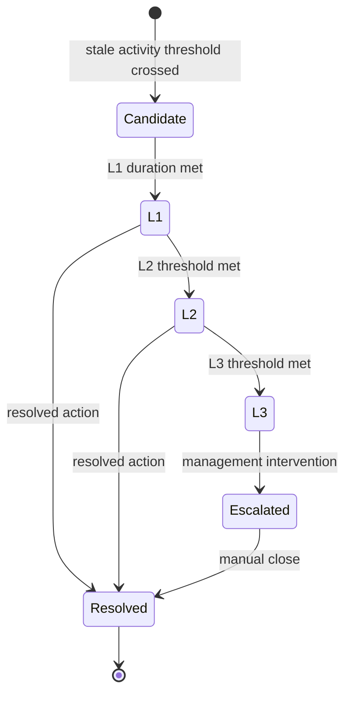

---

## 7) Blocker actions and escalation

**Why it exists**: Detection alone is not enough; users need clear next steps.

### Before
- Blocker list exists but responsibilities are unclear.

### Steps
1. UI action triggers: prompt developer, notify lead, escalate, or mark resolved.
2. Action is persisted in blocker timeline/history.
3. Action events are emitted for audit and real-time consumers.
4. Resolution state updates related views.

### After
- Faster closure and traceable accountability.
- Less blocker noise and more explicit ownership.

### Diagram

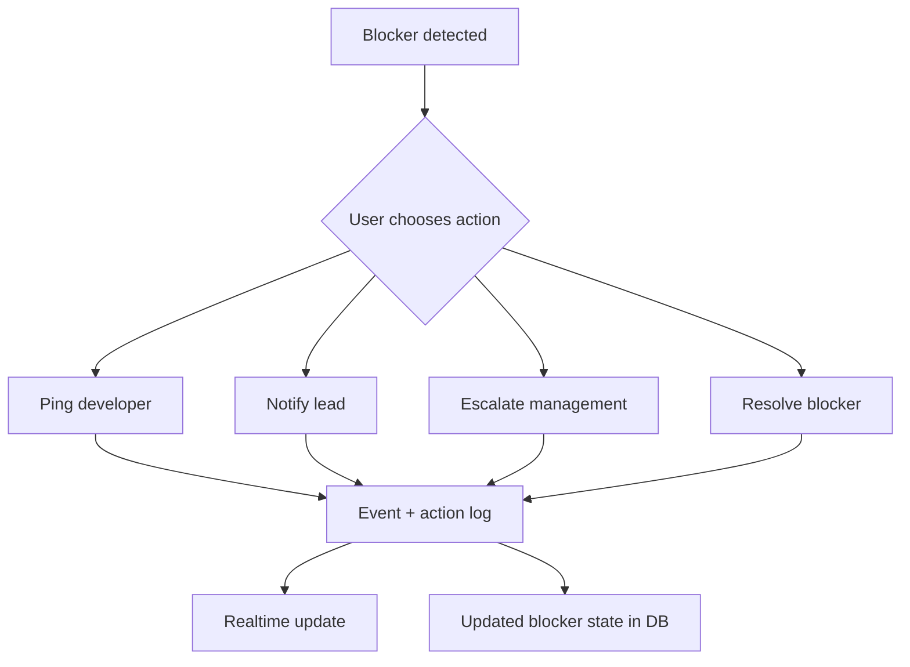

---

## 8) Integration onboarding and synchronization

**Why it exists**: The platform must consume multiple delivery systems and normalize them.

### Before
- Separate silos: Trello/Jira/Planner/GitHub all hold partial truth.

### Steps
1. User connects an account (OAuth/token-based).
2. Credentials/account metadata is stored as integration account.
3. User triggers import/sync or relies on scheduled sync.
4. Provider adapter fetches external entities.
5. Data is normalized into internal entities.
6. Upserts occur in database.
7. Integration sync logs are updated.

### After
- One operating dataset across heterogeneous providers.
- Downstream KPI/blocker pipelines work on normalized tasks.

### Diagram

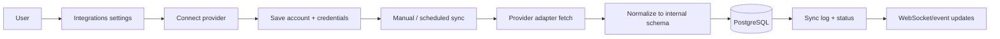

---

## 9) Integration health and diagnostics

**Why it exists**: Failed integrations quickly invalidate all downstream reports.

### Before
- No confidence in whether external sync currently works.

### Steps
1. Health endpoint checks credentials and API reachability.
2. Health state is surfaced per account and provider.
3. Sync logs carry per-run success/failure and reason.
4. Users can remediate by reauthenticating or fixing scopes.

### After
- Faster incident discovery before KPI drift accumulates.
- Better trust in reporting quality.

---

## 10) Repository mismatch detection

**Why it exists**: Ticket progression and repository activity may diverge.

### Before
- Team assumes ticket status reflects code progress, or vice versa.

### Steps
1. Repository analyzer scans repository events (commit/PR-like activity).
2. Analyzer maps activity against project-ticket identifiers.
3. Service compares mapped activity with ticket/sprint state.
4. Mismatch records are emitted when expectations fail.

### After
- Delivery truth is more reliable.
- Teams can fix process gaps between devs and trackers.

### Diagram

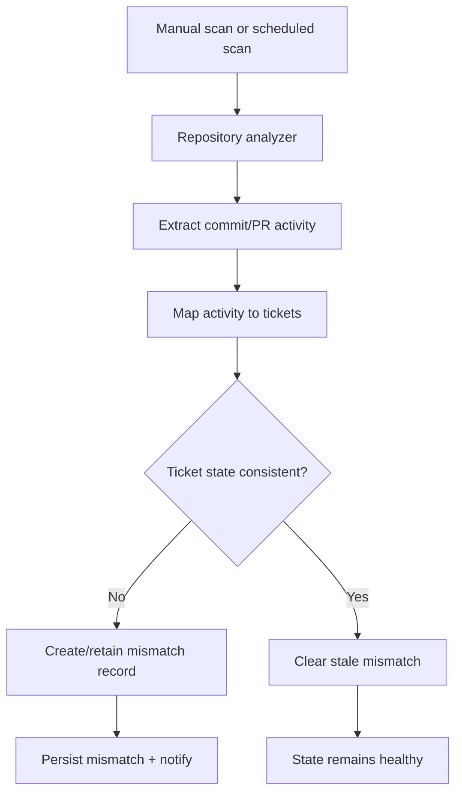

---

## 11) Sprint assistant (contextual Q&A)

**Why it exists**: Humans need rapid understanding across many screens.

### Before
- Users ask repetitive “where is this blocked / why this slipped?” across multiple pages.

### Steps
1. User submits question in assistant interface.
2. Backend receives query with project context.
3. Retriever fetches relevant indexed chunks from vector store.
4. Domain data (tickets/blockers/KPIs) enriches retrieval output.
5. Response is returned with contextual references.

### After
- Faster issue understanding and decision preparation.
- Reduced manual navigation burden.

### Diagram

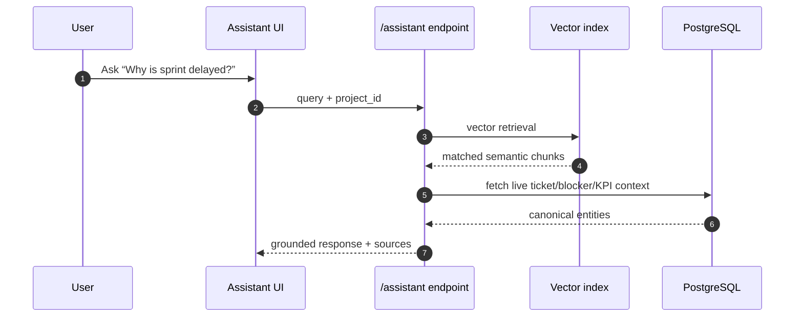

---

## 12) Real-time update layer

**Why it exists**: Background scans and integrations should reflect quickly without constant polling.

### Before
- Users see stale metrics until page reloads.

### Steps
1. Workers publish domain events to Redis-backed bus.
2. WebSocket routes read event stream.
3. Frontend subscribed to project/global channels receives updates.
4. UI invalidates or updates relevant views.

### After
- KPI changes, blocker transitions, and sync updates surface quickly.
- Better operational reactivity.

### Diagram

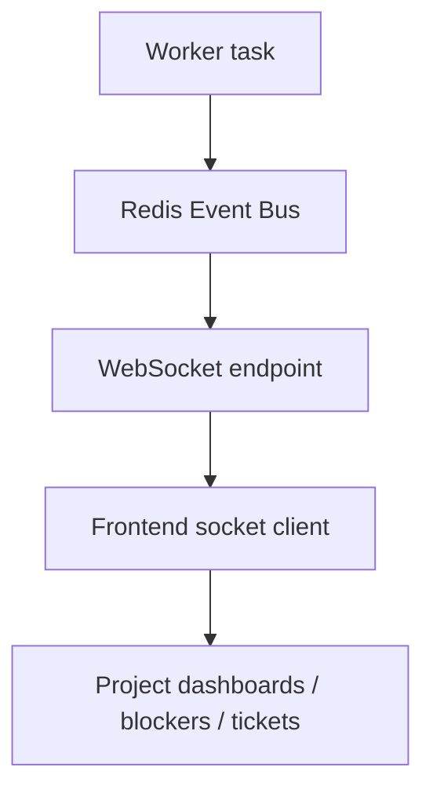

---

## 13) Background job orchestration

**Why it exists**: heavy work must be asynchronous to keep UI responsive.

### Before
- Sync scans and recomputations inside request path would slow user experience.

### Steps
1. Schedule tasks with Celery Beat or trigger manually.
2. Workers execute periodic scans: tickets, blockers, KPIs, repository checks, provider sync.
3. Services persist outputs in DB and publish events.
4. UI refreshes through websocket or query invalidation.

### After
- Near real-time intelligence without degrading API latency.
- Better reliability for long-running tasks.

### Diagram

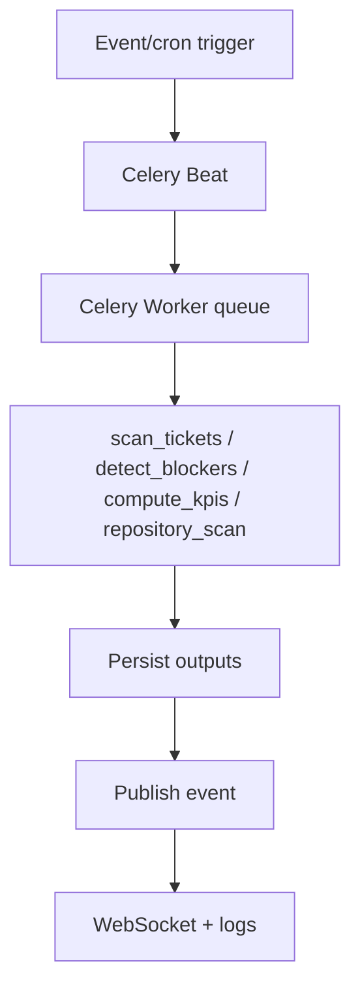

---

## 14) Developer insights and responsiveness

**Why it exists**: Team health requires both aggregate and individual metrics.

### Before
- Progress is visible only at sprint/project level.
- Individual productivity signals are hard to compare.

### Steps
1. Gather assignment and delivery history.
2. Build per-developer KPIs, responsiveness, throughput, trend.
3. Expose views for managers, vendors, and developers.

### After
- Better staffing decisions and coaching insights.
- Visibility into individual delivery reliability.

---

## 15) Recruiting network and visibility workflows

**Why it exists**: In outsourcing-heavy workflows, delivery readiness and staffing history are business-critical.

### Before
- Developer-client relationship data is manual and fragmented.

### Steps
1. Maintain vendor/developer records and candidate-related history.
2. Allow visibility requests and client-specific association workflows.
3. Present recruiting/network summaries in dedicated views.

### After
- Faster staffing alignment.
- Better auditability of who delivered what for whom.

---

## 16) Observability, quality gates, and production confidence

**Why it exists**: A delivery analytics platform must be trusted before stakeholders rely on it.

### Before
- Changes can break behavior without immediate detection.

### Steps
1. Health and metrics endpoints provide liveness/performance signals.
2. CI gates run lint/type tests/unit/e2e and data quality checks.
3. Seed validation and integration contracts validate realistic scenarios.
4. Runbooks drive manual verification for demos and releases.

### After
- Controlled release confidence.
- Fewer hidden failures in staging and production.

---

## Cross-feature dependency map

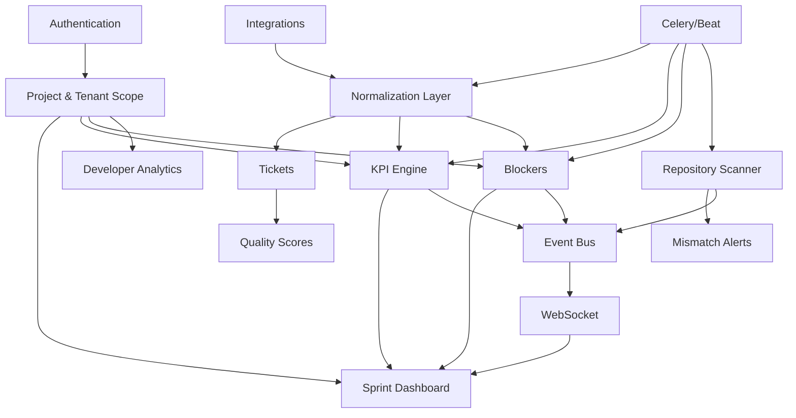

---

## Feature-by-feature summary table

| Feature | Why | Main input | Output | Main outcome |
| --- | --- | --- | --- | --- |
| Authentication | Secure access | Credentials / token | user session | protected and scoped operations |
| Project context | Avoid ambiguity | active project | filtered queries | correct project KPIs and actions |
| KPI dashboard | Delivery health visibility | sprint + ticket history | cycle/lead/completion/velocity | early trend awareness |
| Ticket quality | Improve planning input quality | ticket metadata | quality scores | lower risk and cleaner backlog |
| Blocker detection | Prevent hidden delays | ticket activity | blocker levels + actions | faster recovery from stalling |
| Integrations | Remove data silos | provider tokens | normalized tasks | cross-tool single operating model |
| Repository scan | Align code with ticket state | repo activity | mismatch records | improved execution truth |
| Assistant | Faster interpretation | natural-language query | contextual answer | reduced context switching |
| Realtime updates | Reduce stale views | background events | push updates | responsive UIs |
| Background jobs | Keep UI fast | periodic schedules | continuously refreshed data | continuous monitoring |

---

## Why this architecture works together

KPIMaster intentionally combines:

- **Synchronized data model** (integrations normalize to one schema)
- **Automated risk intelligence** (quality + blockers + mismatches)
- **Role-aware visibility** (different operational truths for each persona)
- **Event-driven UI updates** (less staleness)

This gives teams a practical operating advantage: not just information, but **timely, actionable operating signals**.
