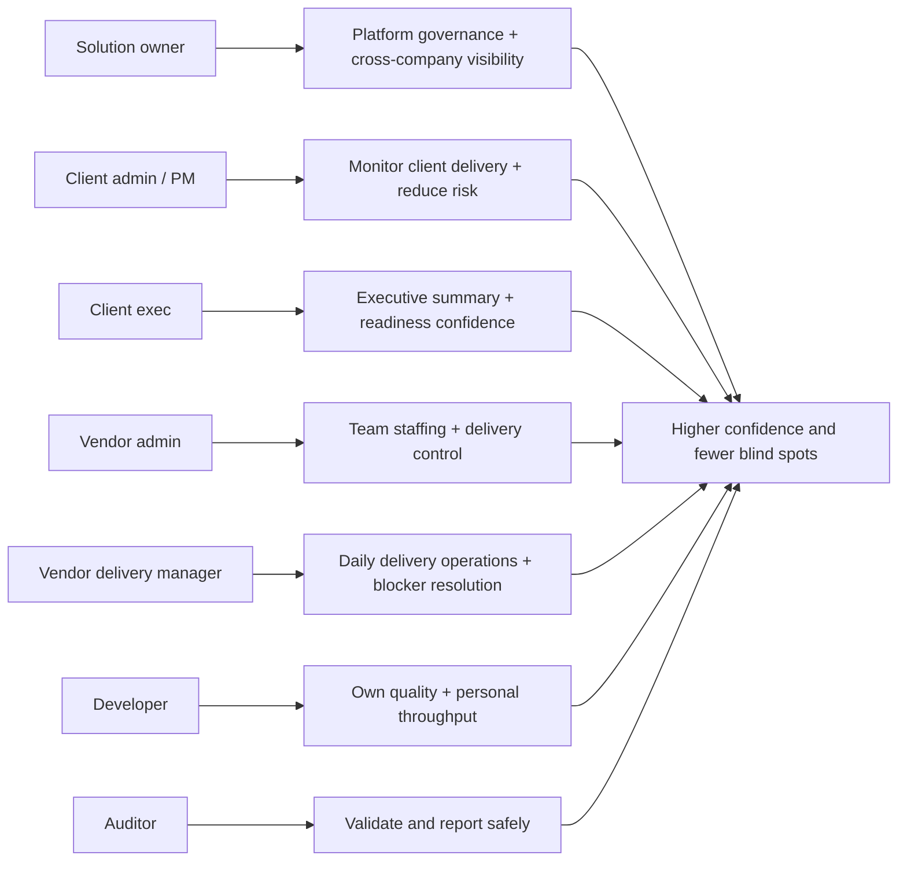
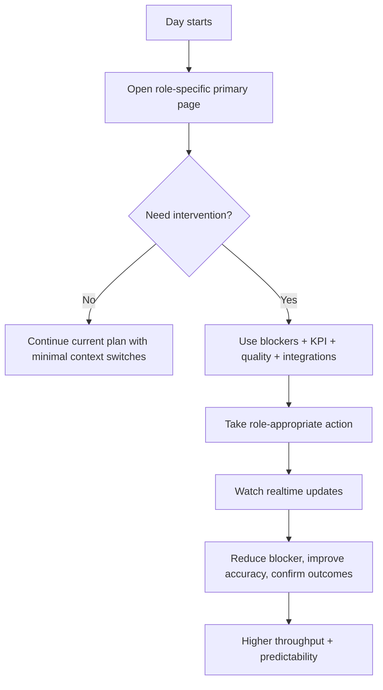
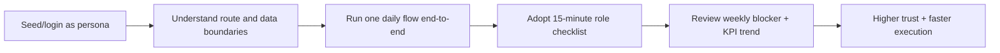

# Persona Productivity Guide

This guide documents every KPIMaster persona, what each person can do, and how each capability improves their productivity.

## What this document means by “productivity”

For each role, productivity is measured by:

- Time saved per decision.
- Faster risk detection and action.
- Fewer context switches.
- Better quality of operational decisions.
- Clear visibility and ownership boundaries.

KPIMaster’s value is not just visibility, but **time-to-action** improvement.

---

## Persona list (authoritative)

- Solution owner / platform operator
  - roles: `super_admin`, `Norma solution owner`
- Client admin / client manager
  - roles: `company_admin`, `company_manager`, `company_admin`, `client_admin`, `client_pm`
- Client executive
  - roles: `client_exec`
- Vendor admin
  - roles: `esn_admin`
- Vendor delivery manager
  - roles: `esn_delivery_manager`
- Developer
  - role: `developer`
- Auditor
  - role: `auditor_readonly`

> Legacy role names (`esn_admin`, `esn_delivery_manager`) are still in use in code paths and are compatible with vendor tenant models.

---

## Role-to-goal map

---

## 1) Solution owner / super owner

### Who this role is for

A person coordinating across multiple clients, vendors, and internal teams.

### What they can do

- Access all operational pages and entities (subject to overall platform guardrails).
- Validate cross-tenant flows, integrations, and global health.
- Supervise blockers, KPIs, onboarding quality, and project ownership structures.
- Run production-like validation scenarios before releases.

### Why this helps productivity

Before KPIMaster:
- Governance work required manual checking across dashboards and scripts.
- Onboarding/integration issues were only found late in demos or after incidents.

After KPIMaster:
- One place for end-to-end checks.
- Faster “green-to-red” risk identification.
- Centralized control of data quality and release visibility.

### Practical workflow

1. Review `/dashboard` for global delivery exceptions.
2. Open blocked areas from `/blockers` and `/analytics/responsiveness`.
3. Validate integration health from `/integrations` and `/settings`.
4. Trigger or verify seed/demo data quality checks in admin workflows.
5. Escalate through blocker state transitions and monitor resolution.

### Productivity outcome

- Reduced meeting prep time for steering reviews.
- Faster root-cause location for integration and delivery failures.
- Higher confidence before client-facing demos.

---

## 2) Client admin / client PM / client manager

### Who this role is for

People responsible for a client company’s project outcome, timelines, and stakeholder updates.

### What they can do

- See project dashboards, sprint monitor, tickets, blockers, repository checks, and developer progress.
- Configure and monitor provider connections.
- Track delivery quality using KPI and quality scores.
- Follow vendor progress and client visibility pages.

### Why this helps productivity

Before:
- PM teams manually pull status from Trello/Jira and compute risks by hand.
- Risk calls (slips/blockers) are delayed because metrics are fragmented.

After:
- One operational surface for all critical health signals.
- Reduced lead time to detect delays.
- Faster and more accurate stakeholder updates.

### Practical workflow

1. Open `/dashboard` and `/sprint` at start of day.
2. Prioritize blockers from `/blockers` by severity.
3. Review ticket quality to prevent poor backlog hygiene.
4. Use `/client-progress` and `/responsiveness` for client-facing updates.
5. Confirm integration health before relying on external data.

### Productivity outcome

- Lower planning overhead.
- Earlier escalation of issues before they become sprint blockers.
- Better narrative for client status calls.

---

## 3) Client executive

### Who this role is for

Program executives and senior stakeholders that need concise risk and trend summaries.

### What they can do

- Access executive-ready delivery views in `/dashboard` and `/client-progress`.
- Read high-level KPI trends, completion health, and major blocker volume.
- Monitor responsiveness and vendor/client progress snapshots.

### Why this helps productivity

Before:
- Heavy operational data reduced executive decision speed.

After:
- Concise, role-suitable view without excessive operational noise.
- Faster go/no-go and escalation decisions.

### Practical workflow

1. Review trend cards and health signals each morning.
2. Validate risk concentration by project and risk type.
3. Use summary pages for weekly steering or quarterly updates.

### Productivity outcome

- Quicker strategic alignment and shorter decision loops.
- Better confidence on go-live timing and delivery commitments.

---

## 4) Vendor admin

### Who this role is for

Vendor operations leadership supervising multiple developers and client assignments.

### What they can do

- Manage vendor dashboard and developer portfolio in `/developers` and `/vendor-dashboard`.
- Track developer responsiveness and assignment health.
- Follow blocker and repository signals related to delivered capacity.
- Help coordinate staffing adjustments and escalation with clients.

### Why this helps productivity

Before:
- Vendor leadership used separate systems for assignment, communication, and reporting.

After:
- One operational lens for capacity, quality, and progress.
- Faster intervention when developer responsiveness or delivery consistency drops.

### Practical workflow

1. Review `/developers` daily.
2. Sort by active blockers and responsiveness trends.
3. Prioritize coaching/reallocation decisions for lagging teams.
4. Coordinate quickly with client-side stakeholders using shared evidence.

### Productivity outcome

- Reduced coordination friction across projects.
- Faster response to underperformance.
- Better staffing efficiency.

---

## 5) Vendor delivery manager

### Who this role is for

A day-to-day delivery manager inside a vendor organization.

### What they can do

- Track real-time team execution signals at developer and engagement levels.
- Act on active blocker states and resolution workflows.
- Observe repository mismatch signals to detect process drift.

### Why this helps productivity

Before:
- Daily operations depended on manual status updates.

After:
- Real-time signaling enables immediate operational corrections.
- Blockers are no longer waiting for periodic standup only.

### Practical workflow

1. Open `/developers` and `/blockers`.
2. Focus on active L2/L3 blockers.
3. Trigger or confirm resolutions and notify responsible leads.
4. Check repository mismatch for consistency issues before they become client disputes.

### Productivity outcome

- Lower blocker dwell time.
- Better predictability across sprint windows.
- Stronger developer accountability using objective signals.

---

## 6) Developer

### Who this role is for

Delivery engineers or contractors owning specific work.

### What they can do

- Access `/developer-dashboard` and `/developer-history`.
- See personal ticket and performance context.
- React to blockers and visibility workflows tied to clients/dev assignments.

### Why this helps productivity

Before:
- Developers frequently re-opened missing or unclear tickets and lost time in confusion.

After:
- Clear personal context and expected work state.
- Faster blocker handling and cleaner focus on assigned deliverables.

### Practical workflow

1. Open personal dashboard to check assigned priorities.
2. Resolve current blockers with action links/state.
3. Review historical context to avoid duplicate work.
4. Improve task quality by resolving ticket quality gaps.

### Productivity outcome

- Less ambiguity and less waiting.
- More focused execution with fewer rework loops.
- Better visibility into personal responsiveness trends.

---

## 7) Auditor

### Who this role is for

People reviewing operational correctness, compliance, and reporting consistency.

### What they can do

- Read project and delivery states across supported surfaces.
- Confirm audit trail artifacts (logs, blocker history, sync results).
- Validate that role isolation and data scopes are respected.

### Why this helps productivity

Before:
- Compliance checks were manual and incomplete.

After:
- Read-only centralized state for repeatable review.
- Faster verification with consistent evidence artifacts.

### Practical workflow

1. Validate route-level visibility and access boundaries.
2. Sample key projects for KPI, blocker, and integration state consistency.
3. Check action history and logs for traceability.
4. Report exceptions with links and timestamps from in-app data.

### Productivity outcome

- Quicker audit cycles.
- Lower review ambiguity and stronger traceability.

---

## What each role gets when adopting KPIMaster well

| Role | Main bottleneck without KPIMaster | KPIMaster replacement |
| --- | --- | --- |
| Solution owner | Manual cross-tenant reconciliation | Single operational control surface |
| Client admin / PM | Fractured status updates from tools | Unified KPI + blocker + quality visibility |
| Client executive | Too much tactical noise | Executive summary and risk-focused health |
| Vendor admin | Weak staffing visibility | Consolidated developer and responsiveness view |
| Vendor delivery manager | Late blocker reaction | Event-driven operational actions |
| Developer | Context uncertainty and unclear ownership | Personal execution + blocker workflow |
| Auditor | Partial evidence and access uncertainty | Centralized read-only validation path |

---

## Productivity playbook by persona

### Notes by role

- Solutions owners should run periodic cross-persona reviews using `/analytics` and `/integrations`.
- Client teams should combine `/sprint`, `/tickets`, and `/blockers` before standups.
- Vendors should pair `/developers` with `/blockers` and repository mismatch pages.
- Developers should start and end day in `/developer-dashboard` to lock personal focus.
- Auditors should validate from read views first, then trace logs and sync states.

---

## How to quickly evaluate if a role is being productive

### Daily checks

- Are critical blockers triaged within expected escalation thresholds?
- Are integrations healthy before planning dependency tasks?
- Are ticket quality problems declining over time?
- Are role-specific pages read first in this order:
  - solution owner/client exec: `/dashboard` -> `/blockers`
  - client PM/admin: `/dashboard` -> `/sprint` -> `/tickets`
  - vendor roles: `/developers` -> `/blockers`
  - developers: `/developer-dashboard` -> `/developer-history`
  - auditor: `/dashboard` -> selected analytics read views

### Weekly checks

- Trend of average blocker resolution duration.
- Ticket quality score movement.
- Responsiveness trend versus baseline.
- Number of stale syncs or failed provider health checks.

---

## Practical onboarding by persona

Suggested first checklists:

- Client PM: 5-minute blocker triage + 10-minute quality sweep + 5-minute KPI validation.
- Vendor manager: 10-minute developer responsiveness review + 10-minute blocker action queue.
- Developer: 15-minute personal sprint alignment + blocker acknowledgment.
- Executive: 10-minute risk board scan with summary export.

---

## Suggested KPI for “productivity lift” measurement

- **Decision latency**: time from blocker creation to first action.
- **Escalation latency**: time from L2/L3 threshold to response.
- **Context switch count**: number of external tools opened to get one decision.
- **Draft update time**: time needed to prepare status communication.
- **Quality backlog time**: percentage of tickets missing required fields before sprint execution.

Track these by persona role for a practical before/after comparison.

---

## Where this document connects

- Start with [personas-and-integrations.md](./personas-and-integrations.md) for permission semantics.
- Follow feature behavior in [feature-deep-dive.md](./feature-deep-dive.md).
- For high-level architecture, use [ARCHITECTURE.md](../ARCHITECTURE.md) and [backend/README.md](../backend/README.md).
