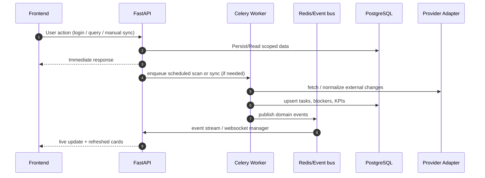
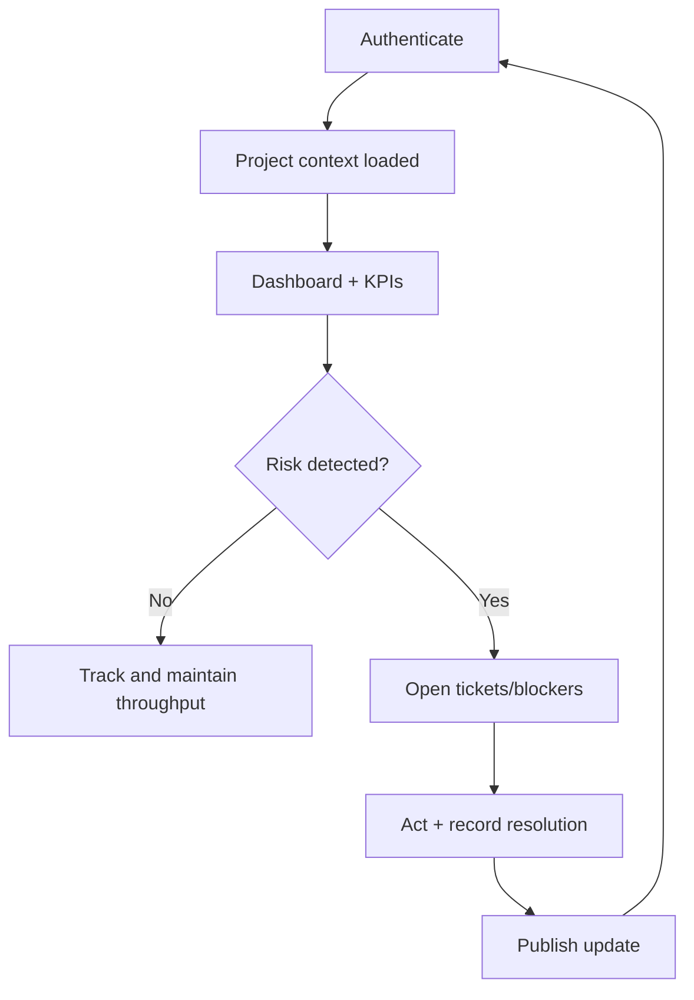
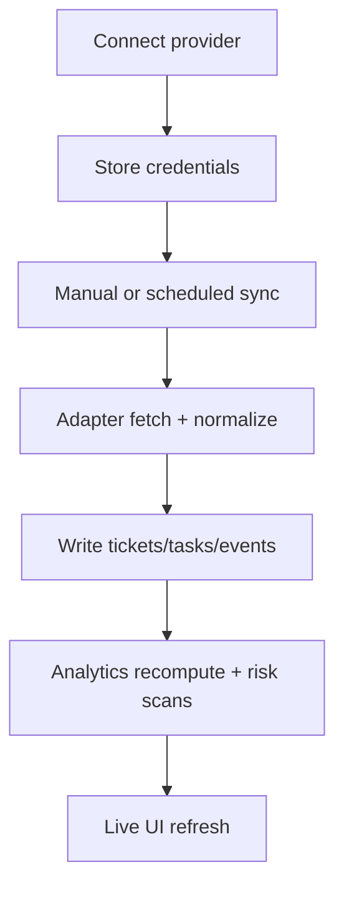
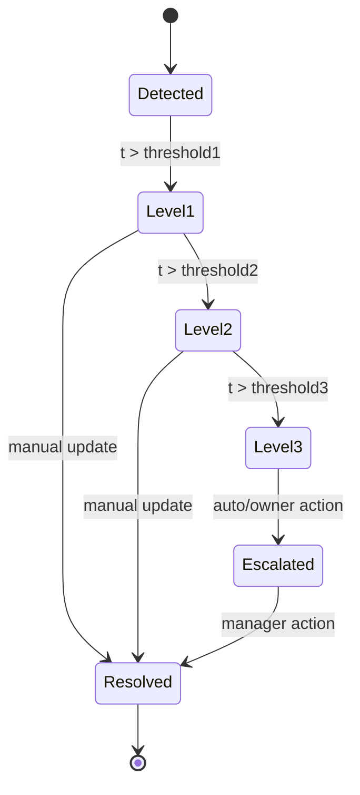

# KPIMaster Platform Details

This document is the definitive “platform deep brief” for KPIMaster.  
It explains what the product is, why it exists, how it works end-to-end, and what people can rely on when using or extending it.

---

## 1) What KPIMaster is

KPIMaster is a **sprint intelligence platform** for distributed delivery.  
It combines:

- Project execution metrics (KPIs, burndown, velocity, completion rate)
- Risk detection (ticket quality, blockers, staleness)
- Integration normalization (Trello/Jira/Planner/GitHub)
- Developer and partner visibility
- Real-time updates and asynchronous processing

It exists to answer one operating question repeatedly in high-velocity teams:

**Are we actually progressing as planned, and if not, what should we do next?**

---

## 2) Core platform intent

- Reduce status ambiguity across tools.
- Convert fragmented events into operational signals.
- Reduce time from incident detection to intervention.
- Align visibility for:
  - clients,
  - vendors,
  - developers,
  - platform owners.

### What “success” means

- A blocker is detected before the sprint goal is missed.
- A role gets the right signal first, without needing manual polling.
- A project owner can explain status in one view instead of multiple systems.

---

## 3) Users and use cases

KPIMaster serves multiple personas:

- `super_admin` / platform operators
- client admins, client PMs, and client executives
- vendor admins and delivery managers
- developers
- auditors

For role behavior and allowed workflows, see:
- [Personas and Integrations](./personas-and-integrations.md)
- [Persona Productivity Guide](./persona-productivity-guide.md)

For feature internals, see:
- [Feature Deep Dive](./feature-deep-dive.md)

---

## 4) Business model and platform boundaries

### In scope

- Normalize external work items into one internal project model.
- Provide operational and executive-grade views over delivery health.
- Detect and escalate risks automatically.
- Provide integration health and live data freshness signals.
- Support cross-tenant role-based workflows.

### Out of scope

- Source code linting and CI/CD pipeline execution.
- Internal engineering toolchain orchestration outside sprint metadata.
- Acting as a replacement for source code review systems.

---

## 5) High-level architecture

```mermaid
flowchart LR
  User[User (Client / Vendor / Developer / Admin)]
  SPA[Frontend SPA<br/>React + Vite + TanStack Query]
  API[FastAPI API<br/>Routers + Authz + Schemas]
  SVC[Service Layer]
  BUS[Redis Event Bus]
  CELERY[Celery + Beat]
  DB[(PostgreSQL)]
  WS[WebSocket Manager]
  INTEG[Integration Providers<br/>Trello / Jira / Planner / GitHub]
  VEC[Vector / RAG Index]

  User --> SPA
  SPA -->|HTTP| API
  API --> SVC
  SVC --> DB
  SVC --> BUS
  BUS --> CELERY
  CELERY --> SVC
  SVC --> API
  CELERY --> WS
  API --> WS
  WS --> SPA
  INTEG --> API
  API --> VEC
```

The API is synchronous for reads/writes, while compute-heavy logic and sync loops are asynchronous via workers/events.

---

## 6) Frontend architecture in platform terms

- **Routing + role gating**: each route resolves user context first, then loads pages according to role and tenant constraints.
- **Data layer**: TanStack Query orchestrates caching, refetch behavior, and request deduplication.
- **State context**:
  - `AuthContext` controls identity, role, permissions.
  - `ProjectContext` controls selected workspace/project for all scoped calls.
- **Live updates**:
  - project/global websocket subscriptions.
  - event-driven invalidation for cards and lists.

### Why this matters

The app remains fast under normal use but still reflects near real-time changes without heavy polling.

---

## 7) Backend architecture in platform terms

- **API layer**: request parsing, schema validation, response typing, and authorization checks.
- **Service layer**: orchestration of business actions (KPI compute, blocker detection, sync reconciliation).
- **Domain layer**: entities/events that represent meaningful operational changes.
- **Repository layer**: persistence contracts for PostgreSQL models.
- **Integration layer**: provider adapters and registry, normalized model conversion.
- **Infrastructure**:
  - Redis event bus
  - WebSocket broadcasting
  - Celery worker execution
  - retry/circuit safety patterns

### Why this matters

It keeps operational logic decoupled from transport concerns so worker jobs, APIs, and adapters can evolve independently.

---

## 8) Data flow: the normal operating cycle



---

## 9) Core feature domains

### 9.1 Identity and access

- Login/registration, JWT issuance, token storage.
- Session restore on app load.
- Hard session invalidation on invalid token.
- RBAC checks in both frontend and backend.

### 9.2 Project workspace and scoping

- Every meaningful action is project-scoped.
- Sidebar/project switcher is source of context for dashboards and reports.
- Project scope protects against cross-project leakage and accidental operations.

### 9.3 KPI computation

- Inputs: ticket states, sprint metadata, completion timestamps, estimation fields.
- Outputs: cycle time, lead time, velocity, completion %, throughput, estimation quality.
- Frequency: real-time reads + periodic recomputation from background jobs.

### 9.4 Blocker intelligence

- Inactivity and progression analysis identifies potential bottlenecks.
- L1/L2/L3 levels encode urgency.
- Escalation actions and resolution history are persisted for governance.

### 9.5 Ticket quality

- Weak metadata and incomplete ticket definition are detected.
- Quality insights are surfaced before execution drift compounds.

### 9.6 Integration normalization

- Trello/Jira/Microsoft/GitHub data is normalized into internal schema.
- Internal pages read normalized models for consistent experience.
- Provider-specific fields are preserved only where needed (e.g., diagnostics, health checks).

### 9.7 Repository mismatch intelligence

- Compares repo activity with ticket/sprint behavior.
- Flags mismatches to prevent false assumptions about real progress.

### 9.8 Assistant/query experience

- Retrieves project context and stores semantic vectors for Q&A.
- Provides quick operational explanation without custom dashboard navigation.

---

## 10) Lifecycle graphs

### Login to value loop



### Integration to intelligence lifecycle



### Blocker correction lifecycle



---

## 11) Deployment and environments

- Local/dev run uses Docker Compose for PostgreSQL + Redis + API and optionally workers.
- Frontend runs with Vite and points to API via `VITE_API_BASE_URL`.
- Backend is configured from environment variables, including:
  - DB and Redis endpoints
  - JWT settings
  - provider API credentials
  - event and worker settings

### Environment expectations

- Secrets are required for non-local runs.
- Provider credentials must match provider-side callback and scope settings.
- HTTPS and strict CORS policy are mandatory for production.

---

## 12) Observability and trust

- Health endpoint for service availability.
- Metrics endpoint for operational insight.
- Sync logs and event logs for integration and worker health.
- Seed/data-quality checks to validate scenario and schema consistency.
- CI gates for frontend, backend, and end-to-end behavior.

Trust model:

- API authorization controls every mutable operation.
- Role checks are enforced before rendering and before state changes.
- Sensitive provider artifacts are encrypted at rest.

---

## 13) Failure model and resilience

- Missing integration credentials: feature is marked unhealthy, existing operations continue where possible.
- Sync errors: captured in sync logs and surfaced.
- Temporary worker lag: mitigated by queueing + retry behavior.
- Invalid token: automatic re-auth path.
- Data mismatch: surfaced via mismatch records and alerts.

---

## 14) Analytics and productivity impact

The platform affects productivity by reducing:

- decision latency
- blocker dwell time
- manual reconciliation effort
- reporting preparation overhead

It improves:

- forecast confidence
- team accountability
- cross-role coordination
- readiness for client-facing communication

---

## 15) Future-oriented extensions

Potential next layers for this platform:

- deeper assistant actions with policy-based approval paths,
- richer anomaly detection for release risk,
- stronger enterprise governance controls,
- predictive completion modeling,
- fine-grained data export and audit packages.

---

## 16) Known constraints (current)

- Some repository mismatch generation may include simulation behavior in non-production contexts depending on local configuration.
- Quality and blocker thresholds are configurable but should be aligned with organizational cadence.
- Provider coverage is strong for current integrations but depends on provider API availability and permissions.

---

## 17) Documentation surface

- [Architecture](../ARCHITECTURE.md)
- [Backend Guide](../backend/README.md)
- [Feature Deep Dive](./feature-deep-dive.md)
- [Persona Productivity Guide](./persona-productivity-guide.md)
- [Personas and Integrations](./personas-and-integrations.md)
- [Demo and Validation Runbook](./demo-and-validation-runbook.md)

---

KPIMaster is designed as a living operations intelligence layer: one place where project reality is normalized, measured, communicated, and corrected.
