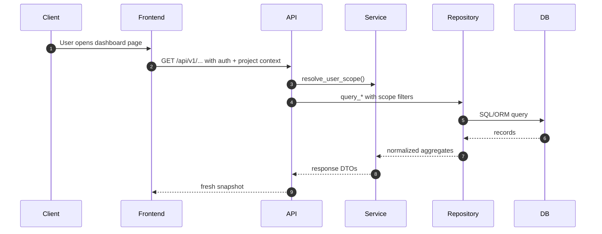
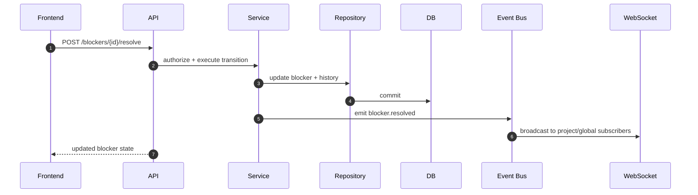
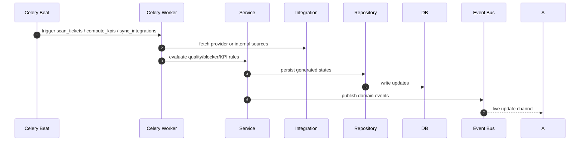
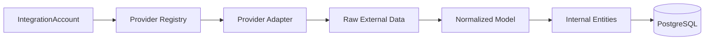
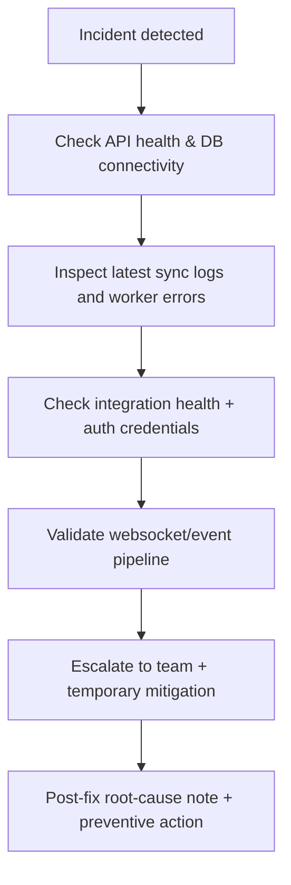

# KPIMaster Technical & Operations Manual

## Purpose

This manual is for technical leaders, platform owners, and implementation teams who need a deep understanding of **how KPIMaster works, how to run it, and how to operate it reliably**.

It complements:
- [Documentation Hub](./README.md)
- [Platform Details](./platform-details.md)
- [Feature Deep Dive](./feature-deep-dive.md)
- [Business Document](./business-document.md)
- [Mobile App Guide](../mobile/README.md)

---

## 1) Platform contract and non-functional guarantees

### 1.1 What KPIMaster guarantees

1. **Scoping discipline**
   - All operational actions happen within authenticated identity + tenant/project scopes.
2. **Near-real-time visibility**
   - Changes from workers are propagated through event bus + websocket channels.
3. **Deterministic role access**
   - UI can hide features, but API authorization remains canonical.
4. **Graceful degradation**
   - Sync/integration failures do not block unrelated pages; failures are logged and surfaced.
5. **Traceability**
   - Blocker and sync actions are persisted as event/state history for audit and support.

### 1.2 Boundaries and explicit non-goals

- **In scope**: sprint intelligence, risk detection, reporting, and role-based delivery operations.
- **Out of scope**: replacing code hosting/CI, replacing issue tracker workflow UI entirely, or providing full workforce management.

### 1.3 Assumptions for reliable operation

- Provider credentials are valid and scoped to needed permissions.
- Project selection is consistently maintained by frontend project context.
- Worker pool has sustained capacity for periodic scans and syncs.
- Observability endpoints are consumed by monitoring tooling.

---

## 2) Logical architecture and responsibility boundaries

```mermaid
flowchart TB
  UI[Frontend (React)] -->|REST| API[FastAPI API]
  API --> Auth[AuthN/AuthZ + authorization]
  API --> Svc[Service Layer]
  Svc --> Repo[Repository Layer]
  Repo --> DB[(PostgreSQL)]

  API --> Bus[Redis Event Bus]
  Bus --> WS[WebSocket Manager]
  WS --> UI

  Svc --> Workers[Celery Workers]
  Workers --> Intg[Integration Adapters]
  Intg --> Ext[External APIs: Trello / Jira / Microsoft / GitHub]

  Workers --> Bus
  Svc --> VEC[Vector/RAG Index]
```

### 2.1 Responsibility boundaries

- **API layer**: transport, input/output validation, authz gates, route-level orchestration.
- **Service layer**: core process orchestration and policy execution.
- **Domain layer**: domain events and conceptual boundaries.
- **Repository layer**: persistence and queries.
- **Integration layer**: external API adapters + normalization contracts.
- **Infrastructure layer**: queueing, websockets, observability, retries, and workers.

---

## 3) Request lifecycle in detail

### 3.1 Read flow (scoped query)



### 3.2 Write flow (action + propagation)



### 3.3 Async scan flow



---

## 4) Runtime topology and process model

### 4.1 Components

- **Frontend container/process**
  - Vite dev server for local development
  - SPA served to browsers
- **Backend API process**
  - Async-capable FastAPI app
- **Worker process(es)**
  - Celery worker consuming asynchronous tasks
- **Scheduler process**
  - Celery Beat for periodic jobs
- **Caches/bus**
  - Redis as broker/backplane
- **State store**
  - PostgreSQL with Alembic migration history

### 4.2 Concurrency and load behavior

- API concurrency is separated from workers.
- Scan/sync jobs are CPU/IO intensive and should not block synchronous HTTP handlers.
- Use queue depth and worker autoscaling to preserve request latency under heavy synchronization load.

### 4.3 Event bus and websocket coherence

- Workers emit domain events whenever significant delivery entities change.
- Websocket routes forward those events to active clients.
- Event payloads should remain compact and consumable by front-end state updaters.

### 4.4 Mobile client runtime (React Native + Expo)

- The mobile app is isolated under `mobile/` and uses the same backend API contracts and auth model.
- API base URL is provided through `EXPO_PUBLIC_API_BASE_URL` at build/run time.
- For Android emulator use `http://10.0.2.2:<api-port>` instead of `localhost`.
- For physical devices use a LAN-reachable backend URL.
- Release APK generation uses Expo prebuild + Gradle local release or EAS build profiles.
- Mobile release checks should include `typecheck`, `lint`, `test`, and one APK build verification.

---

## 5) Domain behavior and event model

### 5.1 Core entities (operational)

- User, Company, Project, Sprint, Ticket, Developer, Blocker, IntegrationAccount, SyncLog, RepositoryMismatch, KPI.

### 5.2 Key state transitions

#### Ticket quality lifecycle

- Raw ticket -> scored ticket -> actionability recommendation

#### Blocker lifecycle

- Candidate -> L1 -> L2 -> L3 -> escalated/resolved

#### Integration account lifecycle

- Created -> connected -> healthy/unhealthy -> disabled

### 5.3 Event examples

- `ticket.scanned`
- `ticket.quality.updated`
- `blocker.detected`
- `blocker.level_upgraded`
- `blocker.resolved`
- `kpi.recomputed`
- `integration.sync.started|finished|failed`
- `repository.mismatch.detected`

---

## 6) Integration operations

### 6.1 Adapter contract (conceptual)



### 6.2 Operational sequence

1. User connects account.
2. Credentials or OAuth token is validated.
3. A project/workspace mapping is established.
4. Initial sync populates canonical entities.
5. Scheduled syncs refresh deltas.
6. Sync logs preserve outcomes.

### 6.3 Integration health policy

- A provider account is “healthy” only when:
  - credentials are valid,
  - required scopes are present,
  - connectivity checks succeed,
  - sync log succeeds according to expected cadence.
- Health checks must be surfaced in UI and reviewed before reporting from that source.

---

## 7) AuthN/AuthZ deep details

### 7.1 Authentication

- Browser login returns JWT token.
- Token carried by all protected endpoints.
- Token invalidation handled by 401/expired handling and local logout cleanup.

### 7.2 Authorization model

- Role + tenant + project scope filters are required for protected endpoints.
- Backend checks must be treated as source of truth even if UI hides elements.

### 7.3 Tenant model

- Tenant separation controls project ownership and cross-project visibility.
- Legacy role names remain supported; migrate only where needed.

---

## 8) Data consistency and correctness

### 8.1 Read consistency expectation

- API reads generally reflect committed DB state.
- Background updates may arrive asynchronously; optimistic refresh patterns are expected.

### 8.2 Important correctness rules

- A ticket change in external source should be normalized before being used by KPI/blocker services.
- Project context must be applied to all operations.
- Duplicate sync artifacts must be idempotent when possible.

### 8.3 Conflict handling

- If external data conflicts with internal state, latest successful sync and timestamped state should dominate; maintain action history for traceability.
- Soft failures in sync should not erase validated internal records.

---

## 9) Deployment topology and operational procedures

### 9.1 Standard local topology

- API + DB + Redis + Worker(+Beat) in local compose profile.
- Migrations run before application traffic.

### 9.2 Environment setup sequence

1. Provision PostgreSQL + Redis.
2. Run migrations to current revision.
3. Seed data where needed.
4. Configure provider env vars and callback URLs.
5. Start API, then workers.
6. Run smoke + data quality validations.

### 9.3 Deployment readiness check

- Environment variables are not defaults.
- Secrets and credentials are properly managed.
- Health and metrics endpoints available.
- Worker scheduling and sync jobs enabled.
- Backup and restore strategy validated.

---

## 10) Observability and incident handling

### 10.1 Required observability surfaces

- `health` endpoint for liveness/readiness.
- `metrics` endpoint for runtime telemetry.
- Worker logs for sync execution.
- Integration sync logs for external failures.
- Frontend error logs for session/API failures.

### 10.2 Incident triage path



### 10.3 SLO-style monitoring expectations

- API availability per environment.
- Average sync duration by provider.
- Worker failure ratio.
- Blocker detection latency.
- Websocket delivery lag.

---

## 11) Performance and scaling guidance

### 11.1 Hot spots

- Large projects with many tickets
- Frequent integration syncs
- Heavy websocket fan-out
- Re-scan frequency too high for small infra

### 11.2 Scaling recommendations

- Increase worker count for scan-heavy workloads.
- Use separate Redis for caching/event and broker if needed.
- Tune DB indexes for high-cardinality project/scanner queries.
- Reduce front-end poll frequency and favor event-driven updates.

---

## 12) Security, encryption, and secrets

### 12.1 Sensitive data handling

- Integration tokens and secrets should remain encrypted at rest.
- JWT secrets must be rotated per environment.

### 12.2 Transport security

- HTTPS in production for frontend/backend and callbacks.
- Strict CORS allowlist.

### 12.3 Access policy

- Principle of least privilege by route and role.
- Restrict admin-only endpoints by role and tenant context.

---

## 13) End-to-end troubleshooting matrix

| Symptom | Probable cause | Immediate checks | Resolution |
| --- | --- | --- | --- |
| Blank dashboard | Missing token or expired session | Check token and `/auth/me` | Re-login, rotate secrets if needed |
| No project appears | No assignments / migration mismatch / seed missing | Check `/projects`, seed scripts, migrations | Seed demo/demo-project and re-login |
| Blockers not updating | Worker down or event dropped | Worker/beat logs, event bus health | Restart workers, inspect queue/backlog |
| Integration fails | Invalid credentials or scope mismatch | Integration health endpoint + account status | Reconnect provider; verify app scopes |
| Repo mismatch not shown | Scan not triggered or repo settings wrong | Trigger scan endpoint, inspect logs | Re-run scan and verify mapping fields |
| Websocket silent | WS route or subscription mismatch | Auth token and active channel | Reconnect client + verify channel subscription |

---

## 14) Advanced troubleshooting playbooks

### 14.1 Worker backlog

- Confirm queue broker alive.
- Confirm task names and arguments are valid.
- Confirm database locks are not saturating.

### 14.2 Sync drift

- Compare sync logs with expected provider event timestamps.
- Validate pagination and rate-limit handling in adapter settings.
- Re-run a targeted sync for one project.

### 14.3 Wrong role behavior

- Validate role claim and tenant mapping in login session.
- Confirm backend authz checks for endpoint.
- Inspect route guards for stale project context.

---

## 15) API and route operating notes

### 15.1 Typical usage pattern

- Read-centric paths: call `/auth/me`, then project-scoped `/projects`, `/sprints`, `/tickets`, `/kpis`, `/blockers`.
- Action paths: blocker transitions, sync triggers, repository manual scans, assistant queries.

### 15.2 Retry behavior

- Critical mutations should be idempotent where possible.
- External sync failures are retried with queue-level policy, not blind UI retry loops.

### 15.3 Versioning

- Current public API base remains `/api/v1` and should remain stable for client apps.

---

## 16) Future hardening and roadmap enablers

- Stronger alerting thresholds by project profile.
- Policy-driven escalation recipients.
- Automated evidence packs for executive reporting.
- Predictive risk scoring from historical blocker patterns.
- Multi-region deployment strategy with resilient event bridge.

---

## 17) Documentation governance

To keep this manual reliable:

1. Update on every service boundary change.
2. Update runbook steps with each new worker or integration.
3. Keep a “known limitations” section current.
4. Link every major architecture decision to source code or ADR notes.

---

## 18) Appendix: operational checklists

### A) Daily

- Confirm API + DB + Redis health.
- Check integration health status.
- Verify blocker queue and unresolved high-severity count.

### B) Weekly

- Validate sync success distribution by provider.
- Review KPI trend for outliers and data completeness.
- Audit active user/project access changes.

### C) Monthly

- Test restore/smoke flow.
- Validate secrets rotation compliance.
- Review worker/performance capacity and adjust queue policy.

---

KPIMaster operations become reliable when you treat this as a production-grade platform: separate request traffic from background compute, monitor event pipelines, and enforce role/project scoping at every layer.
